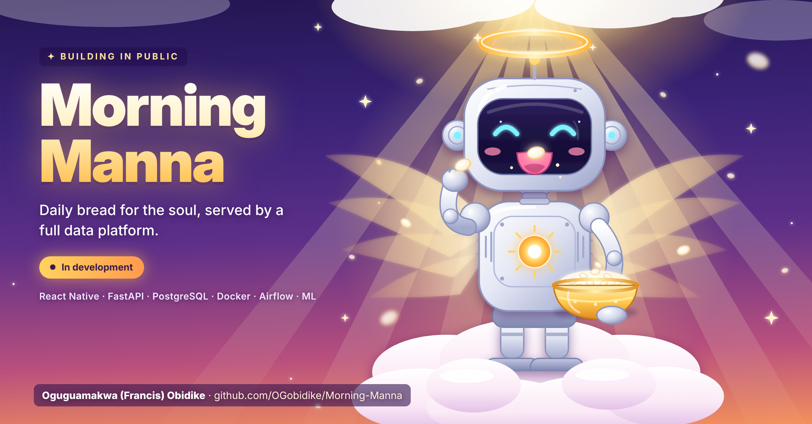
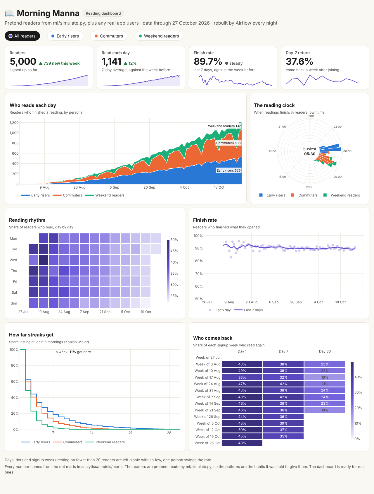
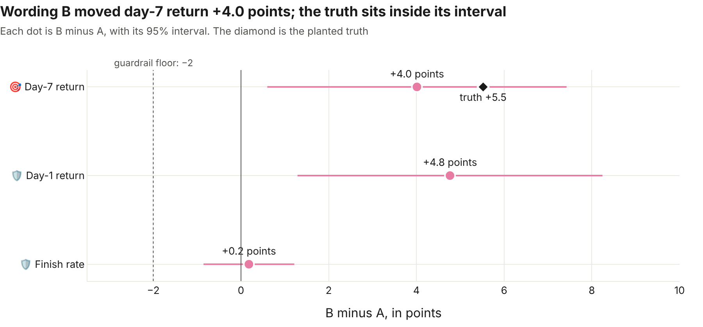
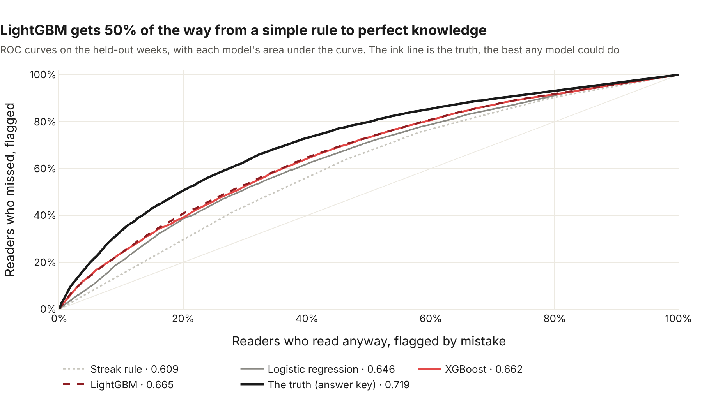
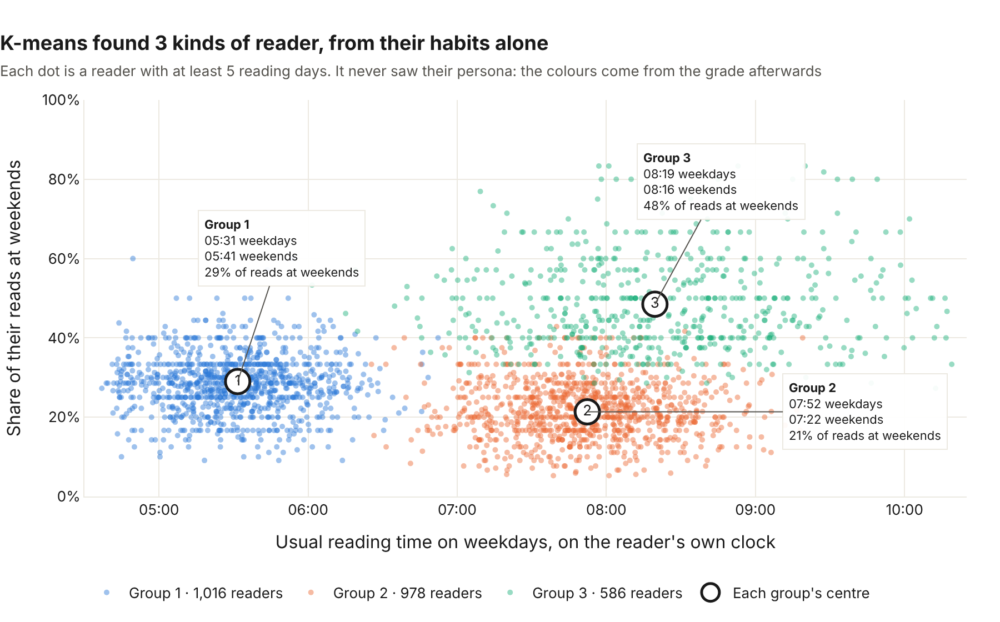
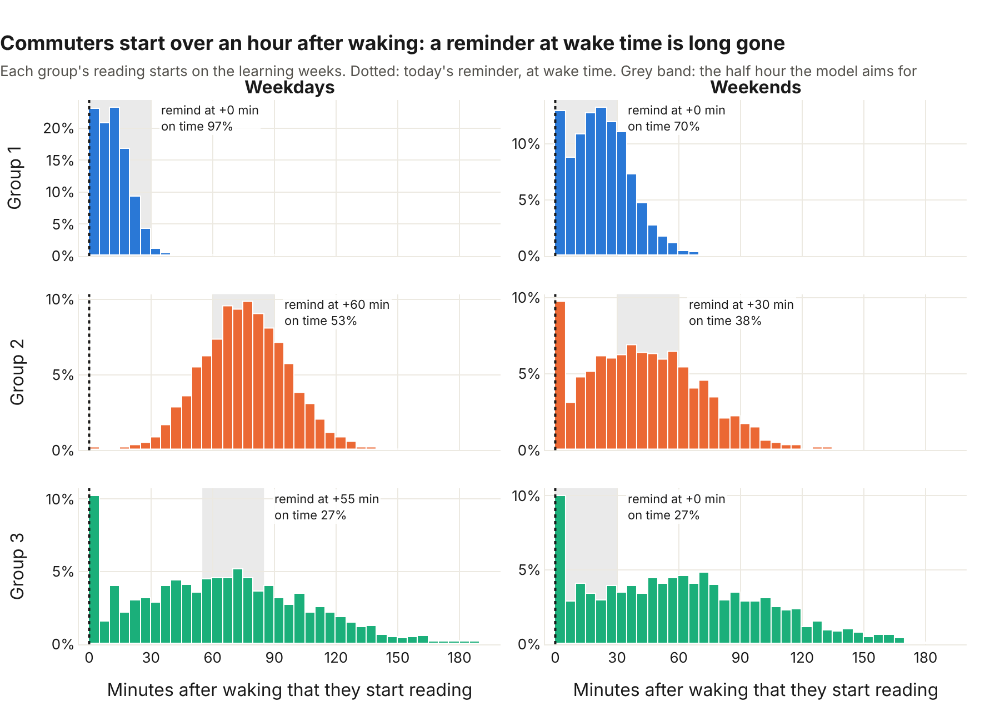
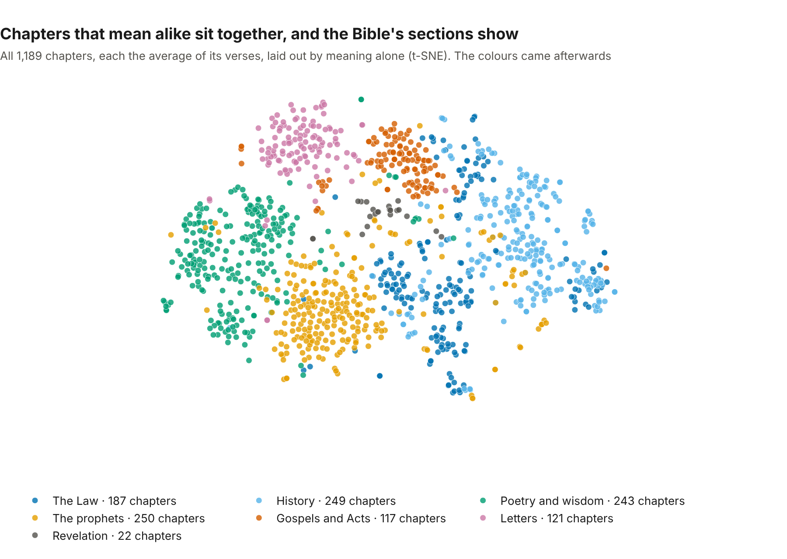
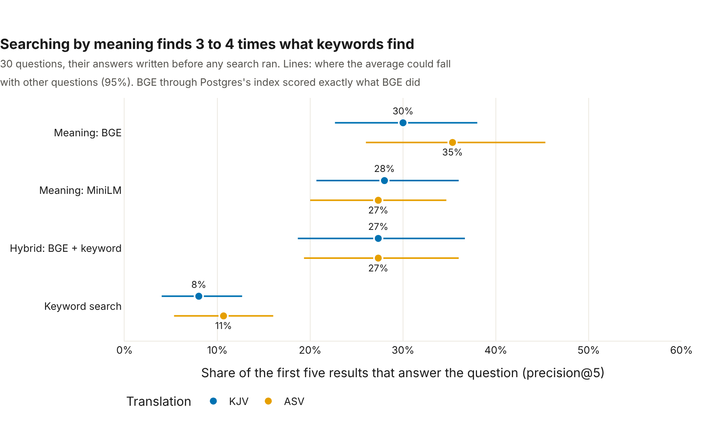
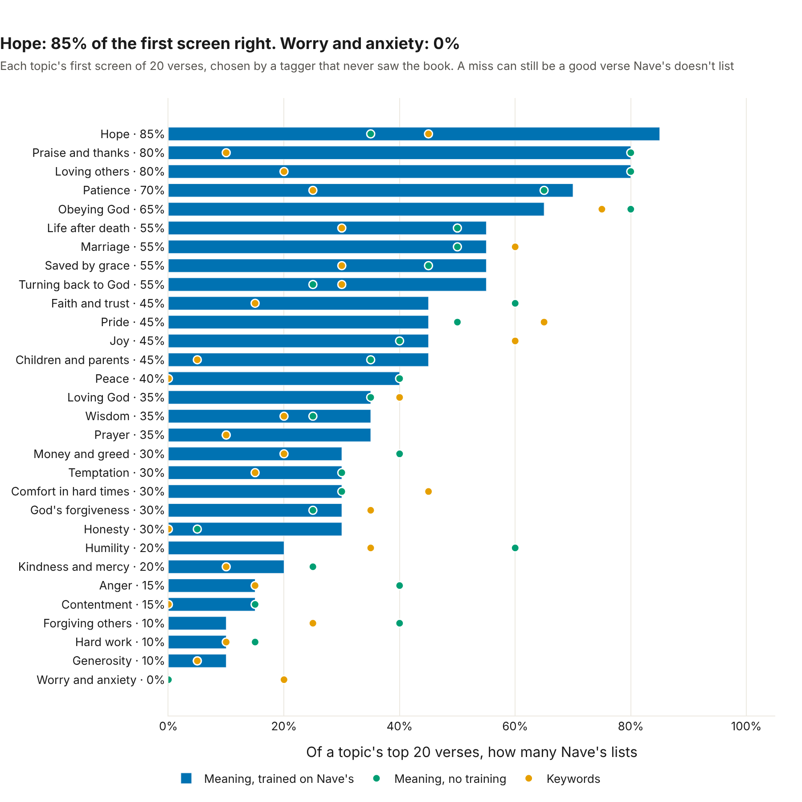
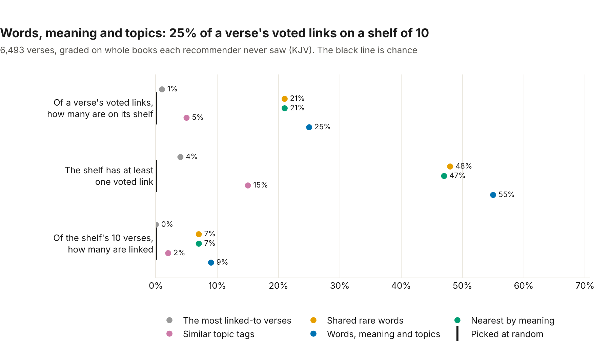

# Morning Manna


Hihi! OG here! smiley day to ya! This project will create a daily Bible reading app for working class people: you can set your wake time, get reminders in the morning,
read one short passage, and other features! 

This is also a full data platform: Contains everything from Python API, ETL pipelines, Airflow, dbt, and analytics dashboards,
and machine learning models for streak-risk prediction, reader personas, and passage
recommendations.

## Da Stack

| Layer | Tools |
|---|---|
| Mobile | React Native (Expo), TypeScript |
| API | Python, FastAPI, PostgreSQL |
| Data | pandas, Airflow, dbt, SeaweedFS (S3) |
| ML / NLP | scikit-learn, XGBoost, LightGBM, MLflow, sentence embeddings, pgvector, LLM API (planned) |
| Ops | Docker, GitHub Actions, AWS (next up) |

## Repository layout

```
backend/     FastAPI service
mobile/      React Native (Expo) app
pipelines/   ETL jobs and Airflow DAGs
analytics/   dbt models and dashboard
ml/          models and experiments
docs/        database diagram, write-ups and pictures
```

## Run it locally

You need Docker. `docker compose up -d --build` starts the whole platform ([below](#-the-models-run-themselves)), and each folder's README has its own quick start: [backend](backend/README.md#quick-start) for the API and the Bible, [mobile](mobile/README.md#run-it) for the app on your phone, then [pipelines](pipelines/README.md), [analytics](analytics/README.md) and [ml](ml/README.md).

The text comes from the King James Version and the American Standard Version (both public domain).

**Status: the API, the Android app, the data platform (lake, loader, Airflow, dbt, and an MLflow model registry), the first analytics (three notebooks, a dashboard and the first A/B test), the machine learning (streak risk, reader personas and reminder times) and the first NLP steps (verse embeddings, search by meaning, topic tags and what to read next) are built. See [backend/README.md](backend/README.md), [mobile/README.md](mobile/README.md), [pipelines/README.md](pipelines/README.md), [analytics/README.md](analytics/README.md) and [ml/README.md](ml/README.md).**

## 📊 The reading dashboard



Who reads, when, how steadily, and who comes back: six charts and four headline tiles drawn from the dbt marts, rebuilt every night by Airflow, with a filter that recolours the whole page by reader persona. See [analytics/README.md](analytics/README.md).

## 🧪 The first A/B test



Two wordings of the morning reminder, tested on 5,000 pretend readers with a planted effect the analysis never saw. Wording B brought **+4.0 points** more readers back on day 7 (95% interval +0.6 to +7.4), and the truth, **+5.5**, sits inside that interval. A drill of **1,200** more practice runs checked the analysis itself. See [the results](docs/analysis/reminder-experiment-results.md).

## 🐳 The models run themselves

`docker compose up -d --build` starts the whole platform: the warehouse, the lake, Airflow, an MLflow server for the model registry, and the ML service on http://localhost:8001. Every night Airflow loads the day's events, rebuilds the warehouse, and scores tonight's streaks with the champion model. Every Sunday it retrains the models on the latest data, and a new model takes over only if it beats the champion on the same held-out nights. The service picks it up by itself. See [ml/README.md](ml/README.md#-the-model-registry-in-docker-card-9).

## 🔥 The streak-at-risk model



Tonight, how likely is a reader on a streak to miss tomorrow morning? Four models answer it, from a simple streak-length rule to XGBoost and LightGBM, graded on three weeks they never saw. **LightGBM** wins by a whisker and gets **half of the way** from the simple rule to perfect knowledge (the simulator's answer key). Nudging its riskiest fifth of readers reaches someone who'd have missed half the time. Every race is tracked in **MLflow**, and a new model becomes the **@champion** only if it beats the old one on the same nights. A small web API serves the champion, and answers for 1,000 readers in about 20 milliseconds. Every night, it scores the readers on a streak and flags who gets a nudge. See [the write-up](docs/analysis/streak-risk-model.md), [the model registry](ml/README.md#-tracking-and-versioning-card-73) and [the service](ml/README.md#-the-streak-at-risk-service-card-74).

## 🧭 Reader personas



Can a model find the kinds of reader from their habits alone? K-means, given four habits and never the persona, found **3 groups**, and they match the simulator's true personas with an **ARI of 0.91** on readers it never saw. It even found that commuters read earlier at weekends. See [the write-up](docs/analysis/reader-personas.md).

## ⏰ The best reminder time



The morning reminder goes off at the reader's wake time, but a commuter starts reading over an hour later, on the train. Built on the personas, a model learns when each reader is about to read and picks the time most likely to land in the half hour before. It closes **92%** of the gap between today's reminder and the best possible, and for commuters on weekdays, on time goes from **1% to 51%**. See [the write-up](docs/analysis/reminder-time.md).

## 🧬 Verse embeddings



Every one of the 62,188 verses is now a vector of its meaning, made by a sentence-transformer model and stored in Postgres with pgvector, ready for search by meaning. Though the model never saw the Bible's sections, a verse's nearest neighbours share its section **62%** of the time, against **17%** by chance. See [the write-up](docs/analysis/verse-embeddings.md).

## 🔎 Search by meaning



Ask in your own words, and get the verses that answer, even when they share no words: "verses about worry" finds "Fear thou not; for I am with thee". Graded on 30 questions whose answers were frozen before any search ran, **searching by meaning finds three to four times what keyword search finds**, and a search takes about 11 milliseconds through Postgres's vector index. Mixing in keywords made it no better. See [the write-up](docs/analysis/semantic-search.md).

## 🏷️ Topic tags



Every verse is tagged with what it's about, from 30 topics a reader would recognise, so the app can offer "more on patience" or a page of verses for hard times. The answer key is **Nave's Topical Bible** (1896), mapped to our tags before any tagger ran. A model trained on Nave's examples wins, graded on whole books it never saw: hope gets **85%** of its first screen right. Worry and anxiety fails, because Nave's files it under worldly care, and the write-up shows why. See [the write-up](docs/analysis/topic-tags.md).

## 📚 Because you read



After a passage, the app can offer 10 verses to read next, each from a different chapter: after John 3:16 comes 1 John 4:9, "God sent his only begotten Son into the world, that we might live through him". The answer key is **OpenBible.info's cross-references**, voted on by readers, with the rules fixed before any recommender ran. **Shared words, meaning and topic tags together** win, graded on whole books they never saw: a shelf holds **25%** of a verse's voted links, and over half of shelves hold at least one. "Readers like you" is built, and switched off until readers choose passages for themselves. See [the write-up](docs/analysis/because-you-read.md).

## License

MIT