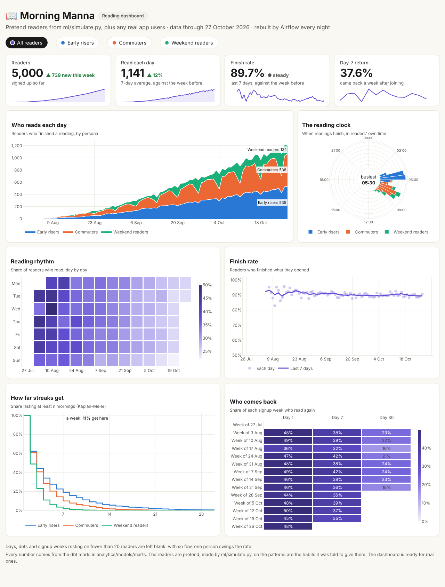
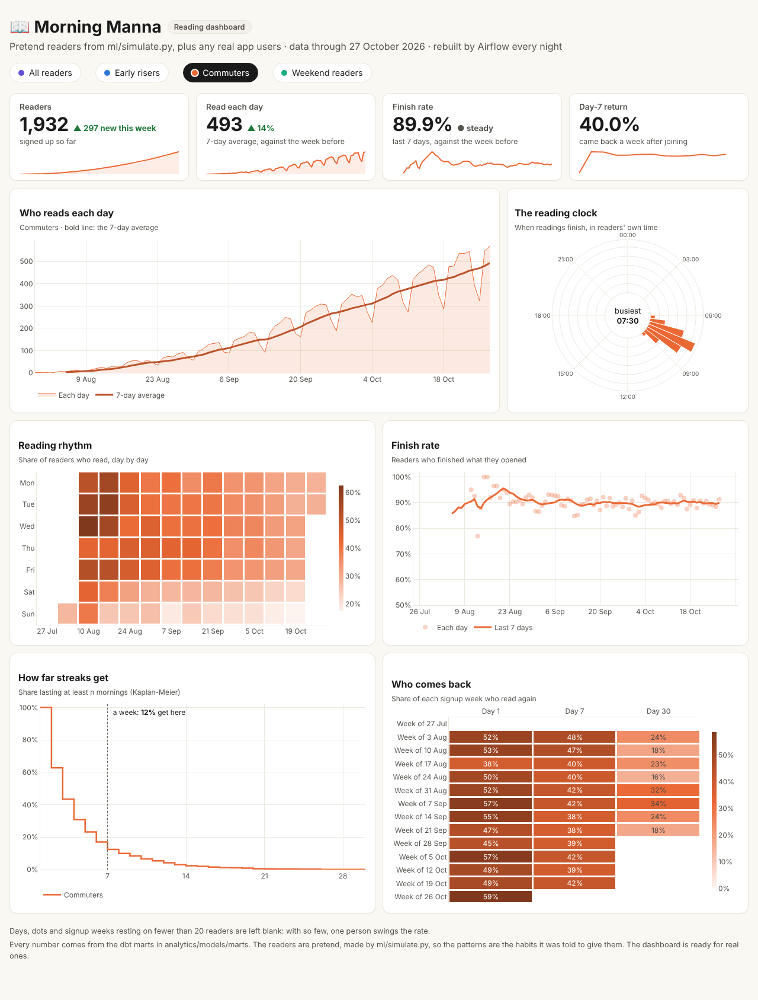
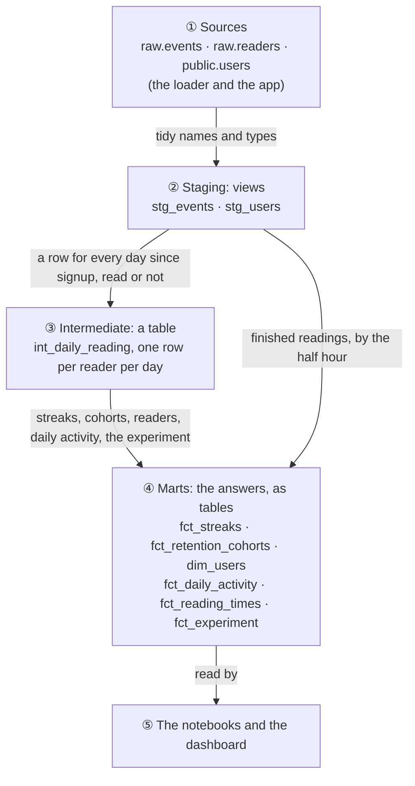
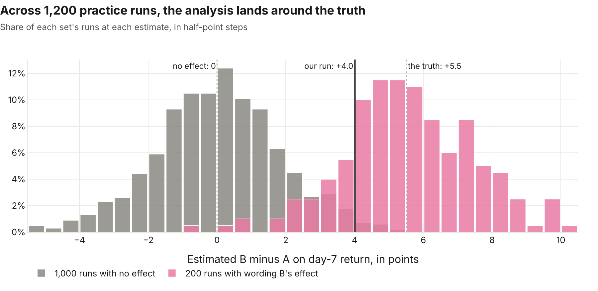

# Morning Manna analytics

The dbt project that turns raw events into the answers that matter most for a daily reading app (who comes back, and who keeps reading), plus the notebooks and the dashboard that show them.

dbt-core 1.12 · dbt-postgres 1.11 · PostgreSQL 16 · Dash 4 · Plotly 6

## 📈 The answers so far

From the pretend readers ([ml/simulate.py](../ml/simulate.py): 5,000 readers, the 90 days to 27 October 2026, seed 7). These are practice data, not real people. Half of them are in group B of the [reminder experiment](#-experiments), which the simulator gave a planted effect, so these numbers include it.

| Measure | Value |
|---|---|
| Came back on day 1 | **49.5%** |
| Came back on day 7 | **40.0%** |
| Came back on day 30 | **23.6%** |
| Finished the reading they opened | **90.0%** |
| Median streak | **2 mornings** |
| Streaks that reach a week | **13%** |
| Longest streak | **39 mornings** |
| Signed up but never read | **917 of 5,000** |

## 📊 The dashboard



Every chart answers one question, and every chart follows the persona filter.

| Panel | The question | How to read it |
|---|---|---|
| **Tiles** | How are we doing this week? | The number, how it moved against the week before (▲ ▼ or *steady*), and its last 90 days as a sparkline |
| **Who reads each day** | How many read, and who are they? | Readers who finished a reading, stacked by persona |
| **The reading clock** | When do people read? | A 24-hour clock of finished readings in each reader's own time zone. Everyone reads in their morning |
| **Reading rhythm** | Which days do they skip? | A wall calendar: each square is a day's share of readers who read. Weeks run left to right |
| **Finish rate** | Do they finish what they open? | Each day as a dot, the last 7 days as a line |
| **How far streaks get** | How long do habits last? | Kaplan-Meier survival curves: the share of streaks lasting at least *n* mornings |
| **Who comes back** | Do new readers stay? | Each signup week's share reading again on day 1, 7 and 30 |

Choose **Commuters** and the whole page turns commuter orange: the weekend rows of the rhythm go pale, and the clock moves to the 07:30 commute.



### Built to be trusted

- **It reads the marts, never raw events.** Every number comes from `analytics.fct_*` and `dim_users`, which `dbt build` has already tested.
- **Colour follows the persona.** The persona colours are a palette checked for colour-blind safety. "All readers" is violet, a colour no persona uses, so a colour never means two things.
- **Small groups stay blank.** A day, dot or signup week resting on fewer than 20 readers is left out, because with so few readers one person swings the rate from 0% to 100%.
- **Never colour alone.** Every series has a legend or a direct label, changes carry ▲ or ▼ and words, and hovering shows the exact numbers behind each mark.
- **Checked against the answer key.** The tests confirm the dashboard finds what the simulator put in: a 90% finish rate, early risers reading before commuters, and commuters skipping Sundays.

### Open it

After `dbt build` (see **▶️ Run it** below), from `analytics/dashboard`:

```bash
../.venv/bin/python app.py
```

Then open http://localhost:8050. The page reads the warehouse each time it loads, so a refresh after Airflow's nightly run shows the new day.

Changing the dashboard's code? Run `python app.py --debug` instead: it reloads on every save and shows Dash's developer tools. It's off by default because it makes the page open about twice as slowly.

| File | What it does |
|---|---|
| [dashboard/data.py](dashboard/data.py) | Asks the marts the questions, and shapes the answers with plain functions the tests can check by hand |
| [dashboard/charts.py](dashboard/charts.py) | Draws each chart: colours, the small-group rule, the shared look |
| [dashboard/app.py](dashboard/app.py) | The page, the persona filter and the tiles |
| [dashboard/assets/style.css](dashboard/assets/style.css) | The warm surfaces of the app's own cards, and a grid that folds to one column on a phone |

## 🏗️ How the tables are built



| Model | One row per | What it holds |
|---|---|---|
| `stg_events` | event | The lake's events, cleaned up |
| `stg_users` | reader | Pretend readers and the app's real users together (as `app:<id>`), with the day each signed up in their own time zone and their reminder group (A or B) |
| `int_daily_reading` | reader per day | From signup to the last day of data: did they read, did they open the app, how many events |
| `fct_streaks` | streak | Each unbroken run of mornings read: start, end, length, and whether it's still going |
| `fct_retention_cohorts` | signup week per persona | How many came back on day 1, 7 and 30, and the rates. Add the rows up for everyone |
| `dim_users` | reader | Longest and current streak, active in the last 7 days, never read |
| `fct_daily_activity` | day per persona | Readers who had joined, readers who read, and how many who opened a reading finished one |
| `fct_reading_times` | half hour per persona | Readings finished in each half hour of the readers' own day |
| `fct_experiment` | reader in the reminder test | Their group, day-1 and day-7 return (once they've had the day), and first-week readings opened and finished |

## 🧭 Decisions

- **The reader's own day.** A morning counts in the reader's own time zone, not the server's. 05:30 in Lagos and 05:30 in Manila are both "this morning".
- **Every reader counts, including those who never came back.** `int_daily_reading` has a row for every day since signup, read or not. Readers who signed up and never read stay in the totals, so retention is never flattered.
- **Only readers who've had time.** Someone who joined yesterday can't have a day 7 yet, so they don't count against day 7 until they've had one.
- **Streaks with gaps and islands.** `day - row_number()` is the same for every day in an unbroken run, so grouping by it finds each streak in one pass.
- **The finish rate counts readers, not events.** Of the readers who opened a reading that day, how many finished one. Counting events instead would break if a reading started before midnight and finished after it.
- **Build, then test, layer by layer.** `dbt build` tests each model before building what depends on it, so a model that fails its tests never feeds the tables after it.

## ▶️ Run it

dbt, the notebooks and the dashboard share a venv of their own. You need the warehouse loaded first (see [pipelines/README.md](../pipelines/README.md#the-loader)).

```bash
docker compose up -d db
cd analytics
python -m venv .venv
source .venv/bin/activate          # Windows (Git Bash): source .venv/Scripts/activate
pip install -r requirements.txt -r notebooks/requirements.txt -r dashboard/requirements.txt
dbt build                          # every model, then its tests
```

dbt finds `profiles.yml` in this folder. It builds into the `analytics` schema of the local docker database, and the `DBT_*` environment variables can point it elsewhere.

Read the answers:

```bash
docker compose exec db psql -U manna -c "select cohort_week, persona, readers, day_1_rate, day_7_rate, day_30_rate from analytics.fct_retention_cohorts order by cohort_week, persona"
```

See every model, column and test, with a lineage graph, in your browser (port 8081, because Airflow uses 8080):

```bash
dbt docs generate
dbt docs serve --port 8081
```

Airflow runs `dbt build` every night after the loader, so the tables are fresh each morning.

## 🧪 Experiments

The first A/B test compares two wordings of the morning reminder. Its plan was written down before any data existed: [docs/analysis/reminder-experiment.md](../docs/analysis/reminder-experiment.md) fixes the measure (day-7 return), the sample size (**1,508 new readers per group**) and how the result will be decided.

Every reader in the test is a row of `fct_experiment`, with the measures the plan decides on. The pretend readers' test runs across the whole simulation; for real app users it began on 2 November 2026, when the app started flipping the coin (`reminder_test_app_start` in [dbt_project.yml](dbt_project.yml)).

[experiments/power.py](experiments/power.py) works out the sample size, and [experiments/analyze.py](experiments/analyze.py) applies the plan's rules in their order: one look at the planned size, the split check, the z-test with its guardrails, and a Bayesian second view. From `analytics/experiments`:

```bash
../.venv/bin/python power.py      # the sample-size table
../.venv/bin/python analyze.py    # the result, as Markdown
../.venv/bin/python drill.py 20 20   # a quick fire drill (the full 1,000 + 200 runs take ~25 min)
../.venv/bin/python charts.py     # the three charts below, as web pages in charts/
```

**The practice run's verdict: switch to wording B.** Day-7 return rose **+4.0 points** (38.2% → 42.3%, 95% interval +0.6 to +7.4, p = 0.021), and neither guardrail dropped. **The reveal:** the effect planted in the simulator is worth **+5.9 points** in one long run, and **+5.5** measured across a 1,200-run drill ([experiments/drill.py](experiments/drill.py)). Both are inside that interval, so the analysis found the right winner. The drill also found that it raises false alarms 7% of the time, not 5%. The whole result is in [docs/analysis/reminder-experiment-results.md](../docs/analysis/reminder-experiment-results.md).



[experiments/charts.py](experiments/charts.py) draws the story in three pictures: the look, the result with the truth marked, and the drill above. Group A is **green** and group B **magenta**, two colours the dashboard doesn't use, so a colour never means two things here. The pair passes the colour-blind checks, and every mark carries a label too.

## 📓 Notebooks

[notebooks/01_reading_habits.ipynb](notebooks/01_reading_habits.ipynb) is the first look at the readers: when they read, which days they skip, and how long their streaks last. The readers are pretend, so the simulator holds an answer key to check the findings against. That makes the notebook a test that the warehouse tells the truth, as well as a look around.

[notebooks/02_reminder_experiment.ipynb](notebooks/02_reminder_experiment.ipynb) tells the reminder experiment's story in three pictures, drawn from `fct_experiment` and the drill's record with the same code as the results page, so the two can never disagree.

Open either in VS Code after `dbt build`, choose the `analytics/.venv` kernel, and click **Run All**.

Notebooks are committed without their outputs or run details, which keeps diffs readable. Clear them before you commit:

```bash
jupyter nbconvert --clear-output --ClearMetadataPreprocessor.enabled=True --inplace notebooks/*.ipynb
```

## ✅ Tests

| What | How many | Run with |
|---|---|---|
| dbt data tests | **46** | `dbt build` |
| Dashboard tests | **34** | `pytest`, from `analytics/dashboard` |
| Experiment tools | **37** | `pytest`, from `analytics/experiments` |

The dbt tests check keys that are unique and never empty, events that belong to a known reader, and allowed values only, plus seven custom checks in [tests/](tests/):

- `one_row_per_reader_per_day`: no reader has the same day twice.
- `streaks_add_up`: each streak's length matches its dates, and all the streaks together add up to every morning read.
- `retention_rates_make_sense`: no more readers returned than were eligible, and every rate is between 0 and 1.
- `daily_activity_makes_sense`: no more readers active, or finishing, than could be, and every finish rate between 0 and 1.
- `reading_times_add_up`: every finished reading lands in exactly one half hour of the clock.
- `experiment_makes_sense`: nobody in the experiment returns on a day they haven't had yet, or finishes more readings than they opened.
- `experiment_matches_retention`: the experiment's day-1 and day-7 counts, added up over both groups, equal the retention cohorts' counts for the pretend readers.

The dashboard tests check the arithmetic on small hand-made tables (Kaplan-Meier, the week-on-week changes, the small-group rule), the warehouse against itself (the personas add up to everyone), and the warehouse against the simulator's answer key.

The **analytics** job in CI builds the warehouse from nothing on every push:

1. The app's tables (migrations).
2. The pretend readers.
3. A stand-in S3 lake.
4. The loader.
5. `dbt build`.

It then prints the day 1, 7 and 30 retention, the size of each experiment group and the experiment's result in the log, runs every notebook from top to bottom, checks each was saved without its outputs, and lints and tests the dashboard and the experiment tools.
