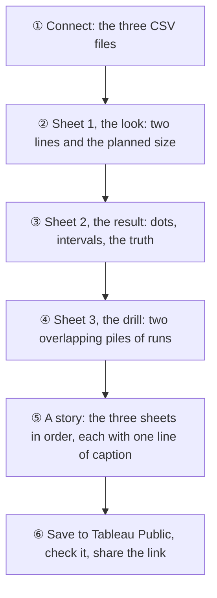

# 📊 The reminder experiment, for Tableau Public

These three files tell the story of Morning Manna's first A/B test: two wordings of the morning reminder, tested on 5,000 pretend readers. They feed a Tableau Public story, so anyone can explore the result without Python or a database.

| File | One row per | Rows | Draws |
|---|---|---|---|
| [experiment_look.csv](experiment_look.csv) | signup day, per group | **166** | 🧮 The look: both groups climbing to 1,508 readers |
| [experiment_result.csv](experiment_result.csv) | measure | **3** | 🎯 The result: B minus A, with its interval and the truth |
| [experiment_drill.csv](experiment_drill.csv) | practice run | **1,200** | 🧯 The drill: where 1,200 more runs landed |

## 🔒 What's in them, and what isn't

Tableau Public is open to everyone, so these files hold **only the pretend readers** (the simulator's practice run) and **only counts and results**. No reader keys, and nothing from a real app user, ever leaves the warehouse.

Every number comes from the same code as the verdict ([analyze.py](../experiments/analyze.py) and [drill.py](../experiments/drill.py)), so Tableau, the charts and [the results page](../../docs/analysis/reminder-experiment-results.md) always agree. CI rebuilds the files on every run and fails if the committed ones are out of date.

To rebuild them, from `analytics/experiments` after `dbt build`:

```bash
../.venv/bin/python tableau.py
```

## 📖 The columns

Differences are in **points** (percentage points): 42.25% against 38.24% is **+4.0 points**.

**experiment_look.csv**

| Column | Meaning |
|---|---|
| `signup_day` | The day the readers joined |
| `group` | `A: Good morning` (the wording everyone had) or `B: New every morning` (the new one) |
| `new_readers` | Readers who joined that day and had reached their 7th day |
| `readers_so_far` | The running total, which the look waits on |
| `planned_size` | 1,508: the readers a group needs before the one look |
| `is_the_look` | `True` on the day both groups first had 1,508 (9 October 2026) |

**experiment_result.csv**

| Column | Meaning |
|---|---|
| `order`, `measure`, `role` | Day-7 return decides; day-1 return and the finish rate are guardrails |
| `a_successes`, `a_total`, `b_successes`, `b_total` | The counts each rate rests on |
| `a_rate_pct`, `b_rate_pct` | Each group's rate, in % |
| `difference_points` | B minus A |
| `low_points`, `high_points` | The 95% interval around it |
| `p_value` | The z-test's p (below 0.05 counts) |
| `guardrail_floor_points` | −2 for guardrails: a drop below it would have stopped the switch |
| `truth_points` | The planted effect's true size, +5.5 (day-7 return only) |

**experiment_drill.csv**

| Column | Meaning |
|---|---|
| `seed` | The run's random seed (an A/A run and an A/B run with the same seed share their readers) |
| `run_set` | `No effect (A/A)`: nothing planted · `Wording B's effect (A/B)`: the real effect planted |
| `estimate_points`, `low_points`, `high_points` | The run's B minus A on day-7 return, with its 95% interval |
| `p_value`, `decision` | What the analysis said |
| `false_alarm` | A/A runs only: `True` if it wrongly said B was better or worse |
| `found_b` | A/B runs only: `True` if it rightly said switch to B |
| `interval_holds_truth` | A/B runs only: `True` if the interval caught the truth |
| `truth_points` | The truth for that set: 0 or +5.5 |

## 🛠️ Building the story on Tableau Public

Tableau is clicked, not coded, so these steps can't run in CI. They follow the free Tableau Public app for Windows; if a menu has moved in your version, the idea stays the same.



### 🎨 The colours

The same as the charts in the repo, so the story looks like one piece of work.

| What | Colour | Red, green, blue |
|---|---|---|
| Group A | `#008300` green | 0, 131, 0 |
| Group B, and the A/B runs | `#e87ba4` magenta | 232, 123, 164 |
| The A/A runs (no effect) | `#8a8983` grey | 138, 137, 131 |
| Lines, labels and the truth | `#1a1a1a` ink | 26, 26, 26 |

Magenta is light on white, so every magenta mark gets a label too.

### ① Connect

1. Start page → **Connect → To a File → Text file** → `experiment_look.csv`.
2. **Data → New Data Source → Text file** for `experiment_result.csv`, then again for `experiment_drill.csv`.
3. In each data source, check that `signup_day` shows a calendar icon (a date) and the `_points` columns show `#` (numbers).

### ② Sheet 1: the look

1. Rename the sheet **The look**.
2. Drag `signup_day` to **Columns**. Right-click it and choose the second **Day** (the green, continuous one).
3. Drag `readers_so_far` to **Rows**.
4. Drag `group` to **Color**. Click **Color → Edit Colors**, double-click each group, and enter its colour from the table above.
5. Drag `group` to **Label** as well. Click **Label** and choose **Line Ends**, so each line is named at its tip.
6. **Analytics** pane → drag **Reference Line** onto the chart, on the `readers_so_far` axis, for the **Table**. Value: **Constant 1508**. Label: *Custom*, `the planned size, 1,508 a group`. Line: dotted grey.
7. Again, onto the `signup_day` axis: **Constant 9 October 2026**, label `the one look, 9 Oct`, solid ink.
8. Title: **Both groups reached 1,508 readers on 9 October: the one look**.

### ③ Sheet 2: the result

1. New sheet, **The result**, using `experiment_result.csv`.
2. Drag `measure` to **Rows**. Right-click it → **Sort** → by field `order`, ascending, so Day-7 return is on top.
3. Create a calculated field **Interval width**: `[high_points] - [low_points]`.
4. Drag `low_points` to **Columns**. Set the mark type to **Gantt Bar**, drag **Interval width** to **Size**, and colour it magenta. This bar is the 95% interval.
5. Drag `difference_points` to **Columns** too. Right-click it → **Dual Axis**, then right-click the top axis → **Synchronize Axis** and untick **Show Header**.
6. On the `difference_points` marks card: mark type **Circle**, magenta, with a white border (**Color → Border**). Drag `difference_points` to **Label**, and format it as `+0.0" points";-0.0" points"`.
7. **Analytics → Reference Line**, per **Cell**: value `truth_points` (Average). Label `truth +5.5`, solid ink. It only appears on Day-7 return, the one row with a truth.
8. **Reference Line** for the **Table**: **Constant −2**, label `guardrail floor: −2`, dotted grey.
9. Title: **Wording B moved day-7 return +4.0 points; the truth sits inside its interval**.

### ④ Sheet 3: the drill

1. New sheet, **The drill**, using `experiment_drill.csv`.
2. Create a calculated field **Estimate, half points**: `FLOOR([estimate_points] * 2) / 2 + 0.25`. In the Data pane, right-click it → **Convert to Dimension**.
3. Drag it to **Columns** (it stays green: a continuous axis).
4. Drag `seed` to **Rows**, and set it to **Measure → Count**. Right-click → **Quick Table Calculation → Percent of Total**, then **Edit Table Calculation → Specific Dimensions**, ticking only **Estimate, half points**. Each set of runs now adds up to 100% on its own.
5. Mark type **Bar**. Drag `run_set` to **Color**: grey for no effect, magenta for wording B's effect, with **Opacity** about 85%.
6. **Analysis → Stack Marks → Off**, so the two piles overlap instead of stacking.
7. Three reference lines on the estimate axis, for the **Table**: **Constant 0** (`no effect: 0`, dotted), **Constant 5.52** (`the truth: +5.5`, dotted), **Constant 4.01** (`our run: +4.0`, solid ink).
8. Title: **Across 1,200 practice runs, the analysis lands around the truth**.

### ⑤ The story

1. **Story → New Story**. Title: **Morning Manna: does a new reminder wording bring readers back?**
2. Drag in the three sheets, in order. Caption each story point:
   - **The look:** we waited for 1,508 readers a group, then looked once
   - **The result:** +4.0 points on day 7, and the truth is inside the interval
   - **The drill:** 1,200 more runs show the analysis finds the truth
3. Add a text box under the title: *5,000 pretend readers, a coin flip for each, and an effect planted in the simulator that the analysis never saw. Code: github.com/OGobidike/Morning-Manna*

### ⑥ Publish

1. **File → Save to Tableau Public As…**, named **Morning Manna: the reminder A/B test**.
2. On the page that opens, click through every story point, hover a few marks, and check the page on a phone.
3. Copy the link. It goes on the main README, next to the result chart.

## 🔗 The published story

*Not published yet.*
