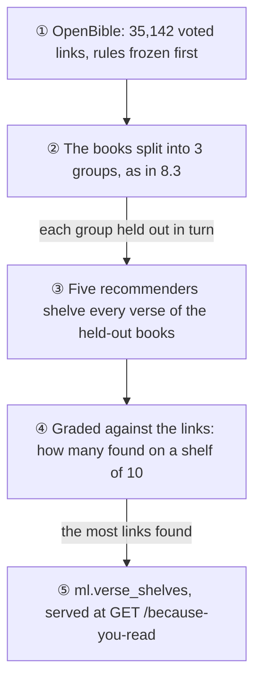
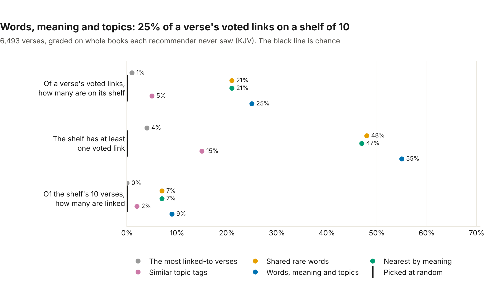
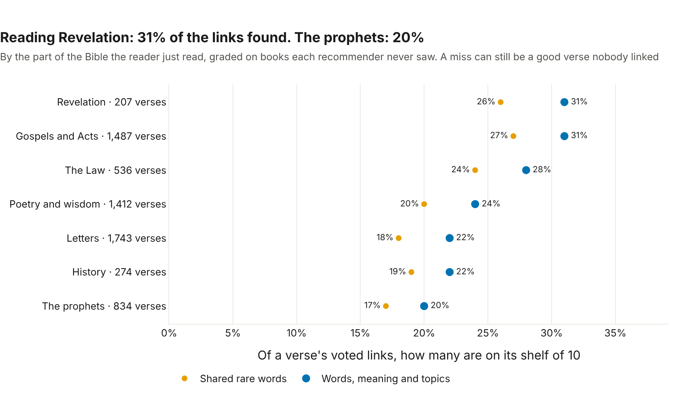

# 📚 Because you read

*Built 5 November 2026 (Card 8.4). The code: [ml/recommend.py](../../ml/recommend.py); the service: [ml/serve.py](../../ml/serve.py).*

A reader who finishes Psalm 23 might want John 10, "I am the good shepherd". So after any passage, the app can now offer a **shelf** of 10 verses to read next: each from a different chapter, and never from the chapter just read.

## 📏 The answer key: OpenBible's cross-references

Shelves need an answer key, and readers have already written one. **OpenBible.info's cross-references** link verses to the verses that shed light on them: 344,799 links, each voted on by readers for how helpful it is. We use the copy published in [scrollmapper's bible_databases](https://github.com/scrollmapper/bible_databases) (CC BY, dated 4 November 2024), checked by its md5 every time it's read.

The rules were written down **before any recommender ran**:

- **A link counts from 10 votes:** the best tenth of the links. Most links have 2 or 3; some are voted down.
- **Links keep their direction.** Reading the "from" verse, the "to" verses are the answer. Only 17% of links are published both ways, so turning them around would invent links readers never voted for.
- **A range counts as found** when any of its verses is on the shelf: Proverbs 8:22–30 is found by Proverbs 8:27.
- **The chapter just read never counts.** Its verses leave every link and are never shelved.

That leaves **35,142 links from 6,493 verses**. One link ends at 3 John 1:15, which the KJV folds into verse 14, and is set aside. A shelf is graded three ways:

| Measure | What it asks |
|---|---|
| **Links found** (recall, the winner's rule) | Of the verse's voted links, how many are on its shelf |
| **A shelf with one** (hit) | Does the shelf hold at least one voted link |
| **Shelf verses linked** (precision) | Of the shelf's 10 verses, how many are in a voted link |

## 🏁 The race



| Recommender | How it picks |
|---|---|
| **The most linked-to verses** | The same popular verses for everyone (Galatians 5:22 is linked to most), counted from the other books |
| **Shared rare words** | The verses sharing the most unusual words (TF-IDF on the KJV text) |
| **Nearest by meaning** | The nearest verses by meaning (8.1's BGE vectors) |
| **Similar topic tags** | The verses with the most similar chances on 8.3's 30 topics |
| **Words, meaning and topics** | All three, each put on one scale, added with weights in tenths |

**Graded on books it never saw.** Each held-out group is graded by recommenders that learned only from the other two: the popular verses are counted from the other books' links, and the blend's weights are picked by how well they did on the other books. Words, meaning and topics learn nothing from the key.

## 🏆 The results



| Recommender | Links found | A shelf with one | Shelf verses linked |
|---|---|---|---|
| The most linked-to verses | 1% | 4% | 0% |
| Shared rare words | 21% | 48% | 7% |
| Nearest by meaning | 21% | 47% | 7% |
| Similar topic tags | 5% | 15% | 2% |
| **Words, meaning and topics** | **25%** | **55%** | **9%** |
| Picked at random | 0% | 0% | 0% |

**The blend wins every measure**, so it's what the app uses, by the rule fixed beforehand (the most links found). It finds **4.0 points more** than shared words alone (95% interval +3.5 to +4.6, resampling whole books; better on 54 of 66 books), and **4.7 more** than meaning alone (+4.1 to +5.3; better on 57 of 66). All three held-out groups chose the same weights: **0.2 words, 0.7 meaning, 0.1 topics**.

Here's what the app shows after John 3:16:

| | Verse |
|---|---|
| 1 John 4:9 | In this was manifested the love of God toward us, because that God sent his only begotten Son into the world, that we might live through him. |
| John 6:40 | And this is the will of him that sent me, that every one which seeth the Son, and believeth on him, may have everlasting life… |
| 1 John 5:1 | Whosoever believeth that Jesus is the Christ is born of God… |
| John 5:26 | For as the Father hath life in himself; so hath he given to the Son to have life in himself; |
| Romans 10:11 | For the scripture saith, Whosoever believeth on him shall not be ashamed. |

Both top picks are voted links: John 3:16 to 1 John 4:9–10 has 618 votes, and to John 6:40, 344. After Psalm 23:1, the shelf opens with Ezekiel 34:23 ("I will set up one shepherd over them") and John 10:11 ("I am the good shepherd").



## 💡 What we learned

### Words and meaning find different links

Shared words and meaning tie, at 21% each, but they don't find the same links. Of the 6,691 links either one finds, only **40% are found by both**. Words find shared phrases; meaning finds the same idea in other words. Together they find more than either, which is why the blend wins, and why it gives meaning most of its weight without dropping words.

### Topics are too broad to point at a verse

Topic tags alone find 5%. Thirty tags are a good way to browse ("more on patience"), but thousands of verses share "salvation", and a cross-reference points at one of them. In the blend, topics get only a tenth of the weight.

### What's popular helps nobody

The most linked-to verses (Galatians 5:22, Isaiah 41:10, Titus 3:5) find 1% of a verse's links. A cross-reference is about the verse just read, so the same shelf for everyone almost never fits.

### KJV English has false friends, again

After Matthew 6:25–34, the lilies of Luke 12:27 come first. But "take no thought" means *don't worry*, and shared words also brings Numbers 33:56, "I shall do unto you, as I thought to do unto them", where *thought* means *intended*. As with "charity" in 8.3, words carry their modern meanings into a 400-year-old text.

## 📖 Passages: a check added after Psalm 23

The race grades single verses, but the app shows a shelf after a whole passage. A passage **pools its verses' shelves**, adding up their scores. Psalm 23 as a whole looked weak: its shelf opens with Psalm 5:7 ("I will come into thy house"), and the shepherds come 4th and 5th. So, before grading any passage, a new rule was written down: grade every run of 6 verses (2,552 with links, the size of a plan day) on its verses' links together, and compare three ways to pool.

| How a passage pools its verses | Links found | A shelf with one | Shelf verses linked |
|---|---|---|---|
| **Adding up their shelf scores (served)** | **11%** | **48%** | **9%** |
| Fusing their ranks, as 8.2 fused its lists | 11% | 49% | 8% |
| The whole passage as one query | 9% | 40% | 7% |

**Adding up the scores finds the most links** (11.5% against 11.0% unrounded), so it stays. The surprise is the third row: asking with the whole passage at once, the "exact" query, does worst. Most links come from one verse, and averaging six verses blurs what each one points to. Psalm 23 was a weak example, not a weak rule. A passage's links found (11%) is lower than a verse's (25%) because a passage has more links to find, and still only 10 places.

## 🔧 A rule that had to change

The blend's weights were to be picked by links found **in whole percents**, ties going to the first weighting in a fixed order, meant so that noise never decides. It did the opposite. Up to 15 of the 66 weightings land within a point of the best, and up to 9 round to the same whole percent, so which ones round up decided the pick: with every weighting's score wobbled by up to 0.02 points, held-out group 0's pick changed in **10%** of wobbles (0.5% without rounding). And it passed over the best weighting on the training books (24.98%) for one at 24.61%.

So the rule was changed, in writing, **before any held-out result under the new rule was seen**: the best unrounded score wins. Both are reported:

| Weights picked by | Words, meaning, topics (per held-out group) | Links found | A shelf with one | Shelf verses linked |
|---|---|---|---|---|
| Whole percents (the frozen rule) | 0.1, 0.7, 0.2 · 0.1, 0.6, 0.3 · 0.2, 0.6, 0.2 | 25.0% | 54.4% | 8.8% |
| **Unrounded (the amended rule)** | **0.2, 0.7, 0.1 in all three** | **25.3%** | **54.6%** | **8.9%** |

The winner doesn't change, and its lead over shared words moves from 3.7 points to 4.0; the amended rule is steadier, giving the same weights in every group.

**How far the records travel.** The whole race was rerun four times with the verse vectors nudged by 0.00001, about the rounding difference between two computers:

- **The by-section numbers for meaning and topics moved by a point** in two runs (a small part of the Bible moves with a single shelf, and topics are retrained on the nudged vectors). So that record keeps only the winner and shared words, which never touches the vectors; it then held in all four.
- **Once in four, held-out group 0 picked the neighbouring weighting**, 0.2 words and 0.8 meaning, which scores 0.04 points behind on the training books. A shelf with one moved from 55% to 54%, and a passage's links found from 11% to 12%. The winner, its lead and the served pooler held.

Picking the best of near-equals can't be made to agree everywhere: unrounded, a nudge can swap two neighbours; rounded, it can move one across a half-percent. So another computer's records should match **within a point**, with the same winner, not byte for byte.

## 👥 Readers like you: built, and switched off

The other kind of recommender learns from readers: "readers who chose this chapter also chose…". It's built (`readers_like_you`, item to item, scored by how often two chapters are chosen by the same readers, with at least 3 in common) and tested on six made-up readers. But it's **switched off**, because today it would learn nothing: everyone on the plan reads the same days, in the same order.

**It switches on when at least 200 readers have each chosen at least 5 chapters themselves** (`collab_status`). Readings of the plan's day never count. Today that's 0 of 200, because the app doesn't yet record a reader opening a passage they chose, such as one from this shelf. That event is the first step to switching it on.

## 🔧 What was built

- **`ml.verse_shelves`**: every KJV verse's 20 best, one per chapter, with the blend's score: **622,040 rows**, replaced in one transaction. Shelves are stored by reference, so the same shelf serves the ASV.
- **`GET /because-you-read`** takes a verse (John 3:16), a chapter (Psalm 23) or a passage (Matthew 6:25–34) and returns its shelf, with the text in either translation.
- **The whole run takes about 4 minutes:** every weighting is graded once on every verse, and each held-out group picks from the other books' rows of that one table.

## ▶️ Run it yourself

From the repo root, with the database up, the verses embedded (`python ml/verse_embeddings.py`) and the topics tagged (`python ml/topics.py`):

```bash
python ml/recommend.py             # about 4 minutes: downloads the links once (8.3 MB), races, stores
python ml/recommend_charts.py      # the two charts above, as web pages in ml/charts/
uvicorn --app-dir ml serve:app --port 8001
curl "http://localhost:8001/because-you-read?book=John&chapter=3&verse=16&k=5"
```

*Cross-reference data: OpenBible.info, [openbible.info/labs/cross-references](https://www.openbible.info/labs/cross-references/), CC BY.*
