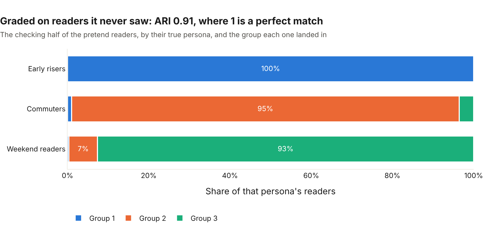
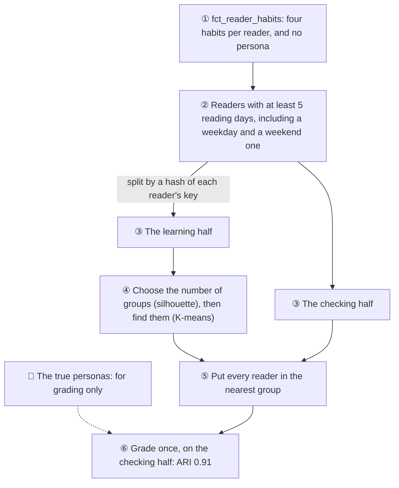
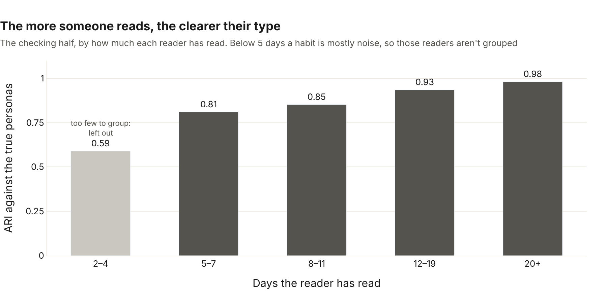

# 🧭 Reader personas

*Found and graded 4 November 2026 (Card 7.6). The code: [ml/personas.py](../../ml/personas.py).*

Not every reader is alike. Some read at dawn every day, some on the way to work, some mostly at weekends. If Morning Manna knows which kind of reader someone is, it can time their reminder better (Card 7.7) and talk to them in a way that fits.

The simulator gives each of my 5,000 pretend readers a persona: **early riser**, **commuter** or **weekend reader**. The dashboard colours by it. So the question for this card was:

**Can a model find those kinds of reader from their habits alone, without ever being told the personas?**

I gave K-means four habits from the warehouse, nothing else, and graded what it found against the true personas afterwards. **It found them: ARI 0.91 on readers it never saw.**

## 🔍 What it found


| Group | Weekdays | Weekends | Reads at weekends | Readers | Turned out to be |
|---|---|---|---|---|---|
| 1 | 05:31 | 05:41 | 29% | 1,016 | Early risers |
| 2 | 07:52 | **07:22** | 21% | 978 | Commuters |
| 3 | 08:19 | 08:16 | **48%** | 586 | Weekend readers |

Each group's habits explain themselves. The early risers read before dawn every day. The weekend readers do nearly half their reading on Saturdays and Sundays. And the commuters read *earlier* at weekends than on weekdays, because on a weekday their reading waits for the commute. Nobody told the model that; it found it in the data.

## 🏁 The grade



**ARI 0.91** (the adjusted Rand index): it compares two ways of sorting the same readers into groups, ignoring what the groups are called. 1 is a perfect match, 0 is no better than chance. Almost every early riser and commuter landed in their own group. The one real mix-up is 7% of weekend readers taken for commuters: late risers who read on enough weekdays to look like a commuter.

## 🧪 How it was kept honest



- **The model never sees the persona.** The warehouse's habits table has no persona column, and a test checks that.
- **The number of groups wasn't given.** The silhouette score (how well separated the groups are) was highest at **3**, out of 2 to 6, on the learning half.
- **One grade, on readers it never saw.** Everything was chosen on the learning half: how many groups, where their centres sit. The checking half was used once, at the end.
- **Choosing the habits.** I tried a few sets of habits before settling on four, and I did that on all the readers, before I'd split them. So I checked the choice again on the learning half alone, and it picks the same four. The full set does best there too (0.92), so the checking half didn't steer it.

## 📏 The four habits

| Habit | What it is |
|---|---|
| Weekday time | When they usually read on Monday to Friday, on their own clock |
| Weekend time | The same, on Saturday and Sunday |
| Weekend share | How much of their reading falls at weekends |
| Time spread | How much their reading time wanders, in minutes |

Each habit is put on the same scale before grouping. Otherwise minutes (in the hundreds) would drown out shares (between 0 and 1).

## 📉 The more someone reads, the clearer their type



With only a few reading days, a habit is mostly noise: someone who read twice, both at weekends, looks like a weekend reader whatever they really are. So readers need at least **5 reading days**, including a weekday and a weekend one, to be grouped. That's **52%** of the pretend readers. The rest either left early or haven't read on both kinds of day yet. As they keep reading, they'll be grouped too.

## 🤔 What it means, and what it doesn't

- **Silhouette isn't truth.** Two habits on their own make groups that are *more* cleanly separated (silhouette 0.54) but match the personas *worse* (ARI 0.83). With real readers there's no answer key, so the habits have to come from knowing the product: *when* people read and *which days*.
- **These are pretend readers**, and their personas were built to be different. Real readers will blur more. The method, the honest split and the grade stay the same.
- **Every reader's group is saved** in `ml.reader_personas`, ready for Card 7.7: the best reminder time for each kind of reader.

## ▶️ Run it yourself

From the repo root, after `dbt build`:

```bash
python ml/personas.py           # finds and grades the groups, saves each reader's group (a few seconds)
python ml/personas_charts.py    # the three charts above, as web pages in ml/charts/
```
