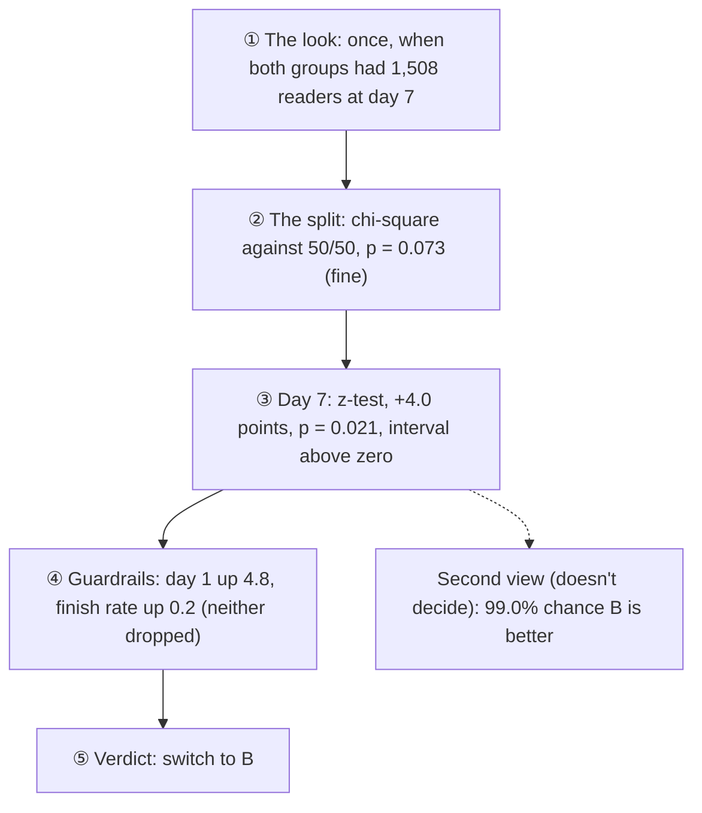

# 🧪 The reminder experiment: the result

*Analysed 2 November 2026, by the rules I wrote down on 1 November, before any data existed ([the pre-registration](reminder-experiment.md)).*

I tested two wordings of Morning Manna's morning reminder against each other. Every new reader got one of them by a coin flip, and the question was simple: does the new wording bring more new readers back on their 7th day?

This first run uses the 5,000 pretend readers from the simulator, so it's a practice run. The coin, the app, the warehouse and the analysis are all real; only the readers are made up.

| Group | Reminder |
|---|---|
| A (what everyone had) | **Good morning ☀️** · Your passage for today is ready. |
| B (the new one) | **New every morning ☀️** · Today's passage is waiting for you. (Lam 3:22–23) |

## 🏁 The verdict: switch to wording B

| Measure | A | B | B minus A | 95% interval | p |
|---|---|---|---|---|---|
| 🎯 **Day-7 return** (decides) | 38.2% (626 of 1,637) | 42.3% (649 of 1,536) | **+4.0 points** | +0.6 to +7.4 points | **0.021** |
| 🛡️ Day-1 return (guardrail) | 46.7% (765 of 1,637) | 51.5% (791 of 1,536) | +4.8 points | +1.3 to +8.2 points | 0.007 |
| 🛡️ Finish rate (guardrail) | 90.2% (5,531 of 6,131) | 90.4% (5,825 of 6,444) | +0.2 points | −0.9 to +1.2 points | 0.73 |

New readers who got wording B were more likely to come back and read on day 7. The difference passes every rule I set: p is below 0.05, the whole interval is above zero, and neither guardrail dropped. Day-1 return actually went **up**.

## 📏 How the rules were applied, in their order

1. **One look, at the planned size.** By 9 October, both groups had at least 1,508 readers who had reached their 7th day (1,637 in A, 1,536 in B). The analysis counts everyone who joined up to then, and nobody after. More pretend readers reached day 7 later, but counting them would have meant looking again.
2. **The split was fine.** 1,637 against 1,536 is uneven, but a fair coin does that this often about 7% of the time (p = 0.073). The alarm was set at 0.1%.
3. **The deciding number.** A two-proportion z-test on day-7 return: +4.0 points, p = 0.021, with a 95% confidence interval from +0.6 to +7.4 points.
4. **The guardrails.** Neither dropped by more than 2 points: day-1 return rose 4.8 points, and the finish rate barely moved (+0.2).
5. **The Bayesian second view.** Starting from no opinion (a flat Beta prior), there's a **99.0%** chance that B beats A on day 7, and the lift is most likely +4.0 points (95% credible interval +0.6 to +7.4). It agrees with the z-test, but by the rules it can't change the decision.

## 📌 Three details I pinned down before looking

The written plan left three things open, so I fixed them in the analysis code ([analyze.py](../../analytics/experiments/analyze.py)) and tested it on made-up numbers before running it on the real data:

- **"1,508 readers who've reached day 7"** is counted by signup day: the look takes everyone who joined up to the first day by which both groups have that many.
- **A guardrail "drops by more than 2 points"** when B minus A is below −2.0 points.
- **If B had won on day 7 but a guardrail had dropped,** wording A would have stayed.

## 🤔 What it means, and what it doesn't

- **The lift is real, but its size is fuzzy.** +4.0 points is the best guess. The data fit anything from a small +0.6 to a big +7.4. With 1,500 readers a group, that's as sharp as the test was built to be.
- **It's a smaller lift than the +5 points I planned for.** The test was sized to catch +5 points 80% of the time, so finding a significant +4 was partly luck of the draw. Being honest about that matters more than celebrating it.
- **These are pretend readers.** The practice run proves the whole chain works, from the coin to the verdict. With real readers, I'd run the same code, unchanged.
- **Readers with reminders off are counted too** (intention to treat). They never see either wording, so they pull the difference towards zero. The effect on readers who actually see the reminder is likely larger.

## 🔍 The reveal: did the analysis catch the truth?

*Opened 3 November 2026, after the verdict above was merged.*

I gave wording B a true effect inside the simulator, written into [simulate.py](../../ml/simulate.py) before any of this ran: on any morning, a group B reader whose reminders are on is 10 points likelier to read (`WORDING_B_LIFT = 0.10`). The analysis never read that number. To see what it's worth on day-7 return, [true_effect.py](../../ml/true_effect.py) simulates the same readers twice, with the effect and without it. Each reader keeps their own random stream, so the only difference between the two runs is the effect itself.

| Wording B's effect on day-7 return | |
|---|---|
| 🎯 What the analysis estimated | **+4.0 points** (95% interval +0.6 to +7.4) |
| 🔑 The truth, in the long run (8,329 group B readers) | **+5.9 points** (± 0.8) |
| 🔑 The truth, in this practice run's 1,536 group B readers | +4.8 points (± 1.8) |

✅ **The interval caught the truth, and the decision was right.** Wording B really does bring more readers back, and the analysis said so.

**Why +4.0 and not +5.9?** Two pieces of luck, both in the same direction:

- **These group B readers were a little less moved than average.** Wording B brought back 4.8 points of them, where the long run says 5.9.
- **The coin put slightly fewer natural returners in group B.** Without the effect, group B would have come back at 37.4% (575 of 1,536), against group A's 38.2%.

Together that's 1.9 points low (1.1 from the first, 0.8 from the second), well inside the interval. That's what the interval is for: with about 1,500 readers a group, an estimate can easily land 3 points either side of the truth.

**A 10-point daily lift is worth 5.9 points on day 7** because the effect can only reach the 85% of readers with reminders on, and only while they're still around. Readers who have already drifted away never see a reminder at all.

**Checked against the warehouse:** the script counts day-7 returns exactly as dbt does: 626 of 1,637 in A and 649 of 1,536 in B at the look, the same as the analysis.

## 🧭 What this means for real readers

- **The analysis can be trusted.** On data where the answer was known, it found the right winner, and its interval held the truth.
- **My "partly luck" worry above was too gloomy.** I wrote it before the reveal, and I've left it as it was. The true effect, +5.9 points, is bigger than the +5 the test was sized for, so the test had a better than 80% chance of spotting it.
- **The size of a win is the uncertain part.** If a real test needs a sharp number rather than just a winner, it needs more readers than 1,508 a group.
- **Next:** the report, with the charts that tell this story at a glance.
