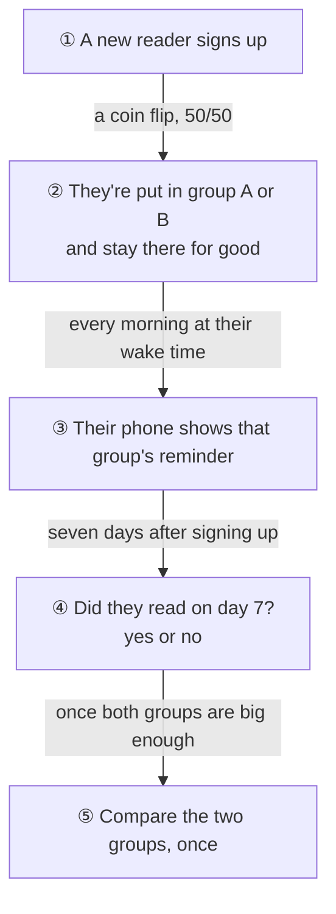

# 🧪 The reminder experiment: pre-registration

*Written 1 November 2026, before any data from the test exists.*

*Added 7 November 2026: the result, by these rules, is in [reminder-experiment-results.md](reminder-experiment-results.md).*

Every morning, Morning Manna sends readers a reminder at the time they wake up. I want to know whether the words in that reminder change whether new readers come back. So I'm going to test two wordings against each other: an A/B test.

This page is the plan, written down *before* the test runs. It fixes what I'm measuring, how many readers I need and how I'll decide, so that once the results come in I can't (even without meaning to) pick whichever number looks best. That's what "pre-registration" means: the rules come first, the data second.

## The two wordings

| Group | Title | Body |
|---|---|---|
| **A** (what readers get today) | Good morning ☀️ | Your passage for today is ready. |
| **B** (the new one) | New every morning ☀️ | Today's passage is waiting for you. (Lam 3:22–23) |

Wording B borrows from Lamentations 3:22–23, *"his mercies… are new every morning"*, which fits an app about reading in the morning. Both use one emoji, so the test compares the words, not the decoration. B differs from A in two ways at once (the scripture line and the reference), so this test can say whether B as a whole works better, not which part of it did the work. That would be a second test.

## What I expect, and what would prove me wrong

- **My guess:** wording B brings more new readers back, because it feels personal and ties the reminder to why people downloaded the app.
- **What the test checks:** whether the share of new readers who come back on day 7 differs between A and B. It's a *two-sided* test, so it would also catch B doing **worse**.

## Who's in it

- **Everyone who signs up while the test runs**, split 50/50 at random when they register. The group is saved with their account and never changes.
- **Counted in their group even if they turn reminders off.** That's on purpose: whether someone allows notifications happens *after* they're assigned, and could itself depend on the wording they'd get. Leaving them out could make one group look better for the wrong reason. (The technical name is *intention to treat*.) The cost is that readers who never see a reminder water the effect down a little.

## What I'll measure

| | Measure | Why |
|---|---|---|
| 🎯 **Primary** | **Day-7 return:** did the reader read on the 7th day after signing up? | The one number that decides the test. It's the same measure as the dashboard's "Day-7 return", **37.6%** today |
| 🛡️ Guardrail | Day-1 return | B mustn't win day 7 by putting people off on day 1 |
| 🛡️ Guardrail | Finish rate (readers who finish the passage they open) | A more tempting reminder mustn't bring people in who then leave half way |
| 👀 Watched, not decided on | Reminder taps (`notification_opened`) | Shows whether readers *noticed* B, even if they don't come back more |

## How many readers I need

The smallest lift worth finding is **+5 points**, from 37.6% to 42.6% coming back on day 7. A smaller lift would hardly change the app; a bigger one is too much to hope for from a few words.

| Smallest lift | Day-7 return | Per group | Both groups |
|---|---|---|---|
| +3 points | 37.6% → 40.6% | 4,153 | 8,306 |
| **+5 points** | **37.6% → 42.6%** | **1,508** | **3,016** |
| +8 points | 37.6% → 45.6% | 595 | 1,190 |

These come from [analytics/experiments/power.py](../../analytics/experiments/power.py), which is tested in CI. They allow for a **5%** chance of "finding" a lift that isn't there, and an **80%** chance of finding a +5 point lift that is.

## How I'll decide

1. **Wait for the planned size.** I'll look at the result once, when both groups have **1,508 readers who've reached their day 7**. Peeking every day and stopping when it looks good is the most common way A/B tests fool people, so there's no early stopping.
2. **Check the split first.** If the groups come out far from 50/50 (a chi-square test with p below 0.001), something is broken in the assignment, and I fix that before trusting any result.
3. **The decision** (two-proportion z-test, 95% confidence interval for the difference):

| Result | What happens |
|---|---|
| B is better (p below 0.05, the whole interval above zero) and neither guardrail drops by more than 2 points | **Switch every reader to wording B** |
| No clear difference | **Keep wording A.** It's simpler, and "no difference" is a real answer too |
| B is worse | **Keep wording A**, and learn from it |

4. **A second view, for understanding only:** a Bayesian analysis (Beta-Binomial, starting from no opinion) gives the chance that B beats A, and how big the lift probably is. It's reported next to the z-test, but it doesn't change the decision above.

## The practice run

Morning Manna doesn't have thousands of readers yet, so the first run of this test uses the 5,000 pretend readers from [ml/simulate.py](../../ml/simulate.py), the same ones the dashboard shows. The assignment, the app and the warehouse are all real; only the readers are simulated.

To make the practice run a real check, the simulator will be given a **true effect** for wording B in a later change. I'll write that number down there, and only compare it with what the analysis finds *after* the analysis is done. If the analysis finds what was put in, it can be trusted with real readers.

## What happens next

| Step | What it adds |
|---|---|
| **This page** | The rules, before the data |
| Assignment | The API puts each new reader in A or B, and the app shows that group's wording |
| The data | The simulator, the loader and a new dbt table, `fct_experiment`: one row per reader in the test |
| The analysis | The z-test, the Bayesian view and the guardrails, following the rules above |
