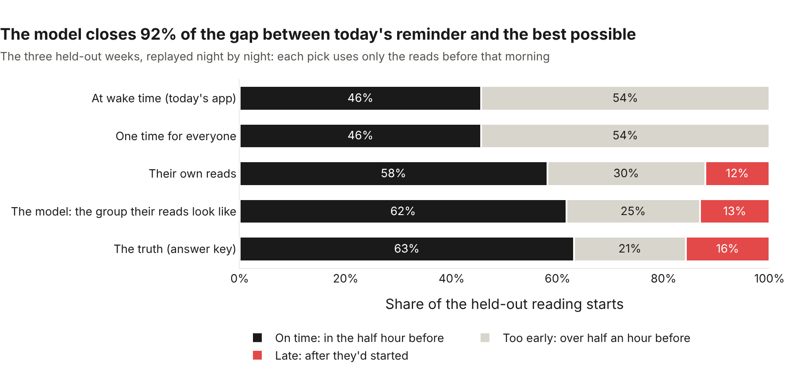
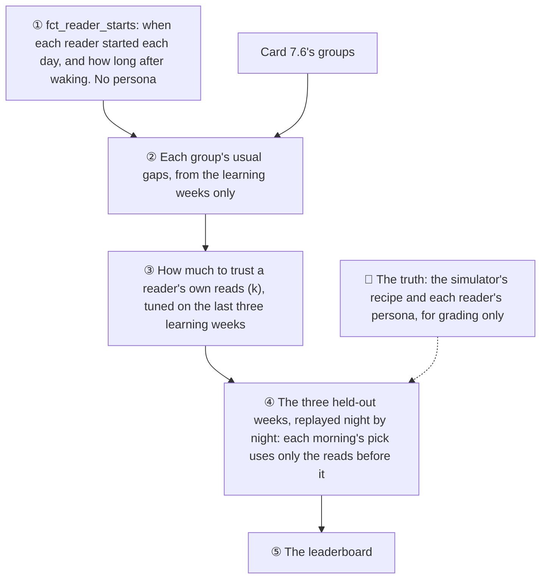

# ⏰ The best reminder time

*Found and graded 4 November 2026 (Card 7.7). The code: [ml/reminder_time.py](../../ml/reminder_time.py).*

Morning Manna sends its morning reminder at the reader's wake time. For an early riser that's right: they open their reading about ten minutes later. But a commuter reads on the train, over an hour after waking, and by then the reminder is long gone. So the question for this card was:

**When should each reader's reminder go off, so it lands just before they'd start reading?**

The model learns, for every reader, how long after waking they usually start, on weekdays and at weekends, and picks the time most likely to land in **the half hour before they start**. Graded on three weeks it never saw, **it closes 92% of the gap** between today's reminder and the best possible. For commuters on weekdays, the share of reminders that land on time goes from **1% to 51%**.

> **What this can and can't say.** The data shows *when* people read. It can't show that a better-timed reminder makes them read *more*: in the simulator, a reminder's timing changes nothing. Proving that takes an experiment with real readers (wake-time reminders against learned ones), which is a natural A/B test for Phase 9.

## 🔍 What it found


Each of [Card 7.6's groups](reader-personas.md) starts reading at its own pace after waking:

| Group | Weekdays | Weekends | Reminder, weekdays | Reminder, weekends |
|---|---|---|---|---|
| 1 (turned out to be early risers) | ~12 min after waking | ~22 min | **at waking** | **at waking** |
| 2 (commuters) | ~76 min | ~43 min | **+60 min** | **+30 min** |
| 3 (weekend readers) | ~64 min, very spread out | ~62 min, very spread out | +55 min | at waking |

Group 3 is the hard one. Its starts are spread across two hours, so every half hour catches only about a quarter of them. When no time is clearly better, the model takes the earliest, at waking, which is never late.

## 🏁 The grade



Five contestants, graded on the 26,674 reading starts in the three held-out weeks:

| Contestant | On time | Too early | Late | Median wait | Gap closed |
|---|---|---|---|---|---|
| At wake time (today's app) | 45.6% | 54.4% | 0% | 38 min | 0% |
| One time for everyone | 45.6% | 54.4% | 0% | 38 min | 0% |
| Their own reads | 58.1% | 29.8% | 12.2% | 20 min | 71% |
| **The model** | **61.7%** | 25.2% | 13.1% | 18 min | **92%** |
| The truth (answer key) | 63.1% | 21.1% | 15.8% | 17 min | 100% |

**The truth** is the best any pick could do: the simulator's own recipe for each reader's gap, known exactly. **One time for everyone** turns out to be the wake time itself: with early risers the biggest group, no single time beats it. **Their own reads** is each reader's own history and nothing else.

By kind of reader, the gain is all where it should be:

| True persona | At wake time | The model | The truth |
|---|---|---|---|
| Commuters, weekdays | 1% | **51%** | 55% |
| Commuters, weekends | 35% | 37% | 38% |
| Early risers, weekdays | 98% | 98% | 98% |
| Early risers, weekends | 71% | 71% | 71% |
| Weekend readers, either | 23 to 26% | 26% | 26 to 27% |

## 🧪 How it was kept honest



- **Replayed as if it re-ran every night.** In the app, the times would be worked out again each night. So each held-out morning's pick uses every read before that morning and nothing after. A test changes a reader's last morning and checks that no earlier pick moves.
- **Tuned before the test.** How much to trust a reader's own reads was chosen on the three learning weeks before the test, the way the streak model was tuned.
- **The groups were checked for a leak.** Card 7.6 found its groups using all 90 days, test weeks included. So I found them again from the learning weeks alone and re-ran everything: the result is the same (61.7% on time).
- **The persona is the answer key.** The starts table has no persona column, and a test checks that only the grading code reads it.

## 🧠 How it picks a time

For one reader, on one kind of day (weekday or weekend):

1. **Which group do their reads look like?** Each group has its usual gaps after waking. Bayes' rule turns the reader's own gaps into a chance of belonging to each group. One or two reads are usually enough to be nearly sure.
2. **Blend in their own reads**, trusted more as they pile up (partial pooling). How much to trust them was tuned, and the answer was **not at all**: in the pretend world, every reader of a kind behaves the same, so a reader's own reads only add noise to their group's pattern. Real readers differ more, and re-tuning will tell.
3. **Pick the time most likely to land in the half hour before they start**, from 0 to 4 hours after waking, in 5-minute steps.

The first version of this didn't do step 3. It averaged the groups' gaps instead, so a reader the model knew nothing about got a reminder about 49 minutes after waking: an average of three kinds of reader that fits none of them, and late for every early riser. **When you're unsure, don't average the answers: pick the one most likely to be right.** For a brand-new reader, that's the wake time.

## 📈 New readers


With no reads yet, the model can only guess (the wake time, the safe choice). **After one or two reads it does as well as the truth.** A reader's own history alone is still behind after ten reads, because a few gaps are mostly noise.

## 🤔 What it means, and what it doesn't

- **It trades a little lateness for a lot less waiting.** The wake-time reminder is never late, but it's too early more than half the time. The model is late 13% of the time (the reader had already started), and the median reminder now waits 18 minutes instead of 38. Whether a late reminder costs more than an early one is a product question, and the half-hour window is a product choice too.
- **These are pretend readers**, built from three tidy kinds. Real readers will vary more within a kind, and that's when blending in their own reads should start to help.
- **Every reader's times are saved** in `ml.reminder_times`: weekday and weekend reminder times on their own clock, and the group their reads look like. That's what the Phase 9 nudge needs to arrive at the right moment.

## ▶️ Run it yourself

From the repo root, after `dbt build` and `python ml/personas.py`:

```bash
python ml/reminder_time.py           # grades the contestants, saves every reader's times (a few seconds)
python ml/reminder_time_charts.py    # the three charts above, as web pages in ml/charts/
```
