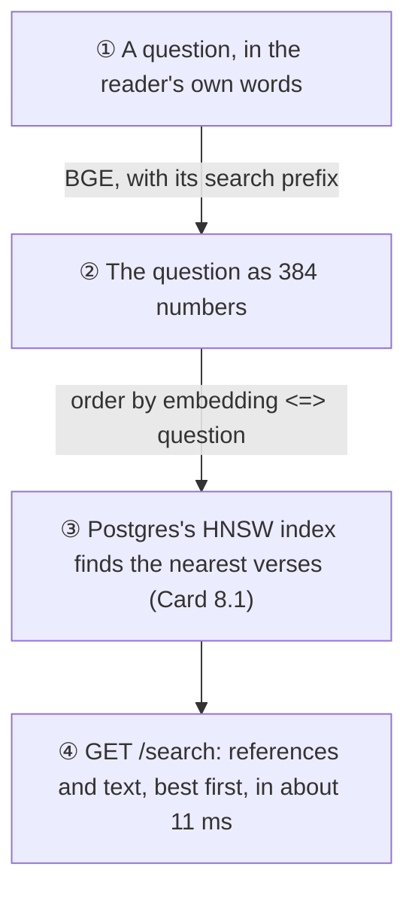
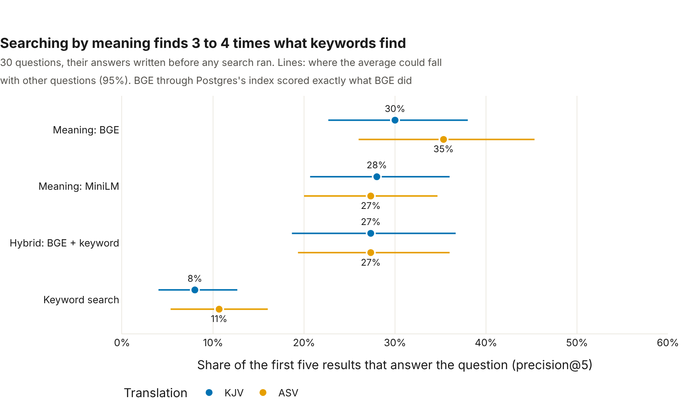
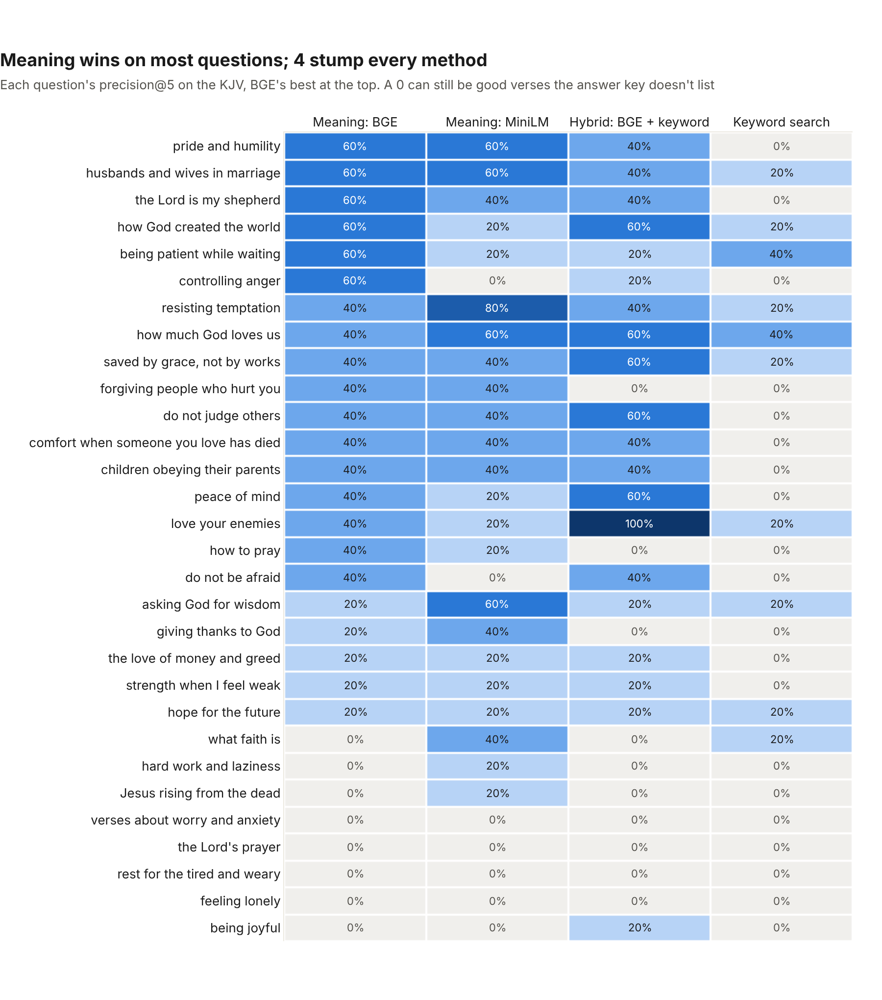

# 🔎 Semantic search

*Built 5 November 2026 (Card 8.2). The code: [ml/search.py](../../ml/search.py); the service: [ml/serve.py](../../ml/serve.py).*

A reader types "verses about worry". The KJV never uses the word: it says "take no thought for the morrow". Keyword search finds nothing. Semantic search turns the question into a vector with the same model that embedded every verse ([Card 8.1](verse-embeddings.md)), and returns the verses whose vectors point the same way, words or no words.

This card builds that search, grades it honestly, and serves it.

## 🔧 What was built



- **`GET /search?q=…`** in the ML service (`ml/serve.py`), next to the streak-risk endpoints. It takes the number of verses (`k`, up to 20), the translation (KJV or ASV) and the method (`meaning`, the default, or `hybrid` or `keyword`).
- **The model loads on the first search**, so the service starts as fast as before. Without the `nlp` extra, or before the verses are embedded, `/search` says plainly what to run (503) and the rest of the service carries on.

## 📏 How it's graded

There's no answer key for meaning in the data, so one was written: [ml/data/search_questions.csv](../../ml/data/search_questions.csv), **30 questions** a reader might ask ("comfort when someone you love has died", "controlling anger", "the Lord is my shepherd"), each with the passages that truly answer it, **622 verses** in all.

**It was written and frozen before any search ran.** A test checks its fingerprint, so it can't be quietly edited after seeing results. With only 30 questions, tuning the questions or the methods to them would be grading the search on itself. For the same reason, every choice was fixed beforehand:

- BGE questions carry the prefix its makers recommend for searching passages; MiniLM's carry none.
- The hybrid uses reciprocal rank fusion with the standard constant, 60, untuned.
- Keyword search matches any word of the question, as stems ("worry" finds "worried"), best match first.

**The measures**, on the first five results (one phone screen):

- **precision@5**: the share of the five that answer the question. The headline.
- **hit@5**: did any of the five?
- **MRR**: 1 over the place of the first good answer (1 if first, 0.5 if second…), averaged.

**Five contestants**, on both translations: keyword search (Postgres's own full-text search), BGE (8.1's model) compared exactly with every verse, BGE through Postgres's HNSW index, a second model (`all-MiniLM-L6-v2`), and a hybrid of BGE and keyword.

## 🏆 The results



| Method | KJV precision@5 | KJV hit@5 | KJV MRR | ASV precision@5 | ASV hit@5 | ASV MRR |
|---|---|---|---|---|---|---|
| **Meaning: BGE** | **30%** | 73% | 0.59 | **35%** | **80%** | **0.74** |
| Meaning: BGE, through the HNSW index | 30% | 73% | 0.59 | 35% | 80% | 0.74 |
| Meaning: MiniLM | 28% | **77%** | **0.67** | 27% | 77% | 0.66 |
| Hybrid: BGE and keyword | 27% | 67% | 0.47 | 27% | 70% | 0.45 |
| Keyword search | 8% | 33% | 0.28 | 11% | 37% | 0.29 |

**Searching by meaning finds three to four times what keywords find**, and nearly three questions in four get at least one right answer on the first screen. BGE, the model 8.1 already stored, is the best on the headline measure in both translations, so it's what `/search` serves.

### How sure can we be, with 30 questions?

Each method answered the same 30 questions, so they can be compared question by question. Drawing the questions again with replacement 10,000 times shows how far each gap could move with other questions (95% intervals):

| BGE against… | KJV | ASV |
|---|---|---|
| Keyword search | **+22 points** (+15 to +30) | **+25 points** (+15 to +35) |
| MiniLM | +2 points (−6 to +11) | +8 points (+1 to +15) |
| The hybrid | +3 points (−5 to +10) | +8 points (0 to +16) |

- **Meaning beats keywords, without doubt.** BGE does better on 19 of the 30 KJV questions and worse on one.
- **BGE and MiniLM are close.** On the KJV it's a tie; on the ASV, BGE is ahead, just. MiniLM even puts its first good answer a little higher on the KJV (MRR 0.67 against 0.59). With two near-equal models, the one already stored and indexed wins: MiniLM would mean a second set of 62,188 vectors for no clear gain.



## 💡 What we learned

### The hybrid didn't help

Hybrid search (meaning and keywords together) is often said to be the best of both. Here it wasn't: **27% against BGE's 30% and 35%**. Fusion helps when both lists are good, and here keyword search is weak: in Bible English, "the Lord is my shepherd" ranks verses by their commonest word, "Lord", and never reaches Psalm 23. Reciprocal rank fusion gives both lists an equal say, so keyword's poor picks push good ones off the first screen. Weighting keywords less might help, but the weight would have to be tuned on questions other than these 30.

It's also slow: keyword search takes about **560 ms** a question, because nothing indexes the verses' words, so Postgres reads and parses every verse of the translation to answer. A full-text index (a backend migration) would fix the speed, but not the ranking, so it's left for a card that needs it.

### The index costs nothing, once it's set right

Postgres's HNSW index is approximate: it walks a graph of neighbours instead of comparing the question with every verse. It scored **exactly** what the exact search did, on every measure and both translations. Its lists aren't always identical: over the 60 searches (30 questions, 2 translations), the first five verses were the same in 55, and in the other five, one to three of them differed. And it's quick:

| Step | Time (median, one question) |
|---|---|
| Turning the question into a vector | 3.5 ms |
| The HNSW index finding the nearest 10 | 2.2 ms |
| The same by comparing every verse (NumPy) | 3.1 ms |
| A whole `/search`, question to verses with text | 10.9 ms |

**A bug the scores missed.** At first, "the Lord's prayer" on the ASV got **2 verses back, not 10**. The index gathers its nearest candidates first (40, by default) from both translations, and only then drops the other translation's. When the nearest are mostly KJV verses, few ASV ones survive. The scores hid it: every method scored 0 on that question anyway, so 2 wrong verses graded the same as 10. Comparing the index's lists with the exact search's, verse by verse, showed it. Now the search weighs 100 candidates (3 ms more), and if it's ever still short, it reads every verse of the translation instead (about 30 ms). A test builds that exact situation and checks the search comes back full.

### The ASV reads better to the model, perhaps

BGE scored **35% on the ASV against 30% on the KJV**. The ASV's English is a little closer to the modern web text the model learned from, which fits 8.1's guess. But the interval for the gap runs from −1 to +12 points, so with 30 questions it's a hint, not a finding.

### The answer key undercounts

The precision here is a **lower bound**. The key lists the best-known passages for each question, not every verse that answers it, and the search can't be credited for good verses the key leaves out:

- **"Jesus rising from the dead"** scores 0%. BGE's five: Acts 13:30 ("But God raised him from the dead"), 1 Corinthians 15:16, Romans 8:11, 2 Timothy 2:8 and 1 Thessalonians 1:10. Every one is about the resurrection, but the key lists the gospels' accounts of the empty tomb and a few other verses, not these.
- **"Verses about worry and anxiety"** scores 0% on the KJV. Its fifth result is Isaiah 41:10, "Fear thou not; for I am with thee", which a reader would gladly take.
- **"Rest for the tired and weary"** finds Job 3:17, "there the weary be at rest": the right words, though not Matthew 11:28's "Come unto me".

Relabelling now, after seeing results, would tilt the grade, so the key stays frozen. A fresh key, written blind by someone else, is how to measure the true precision.

### Where meaning search falls short

- **Named passages.** "The Lord's prayer" finds verses about the Lord and prayer, not Matthew 6:9–13. The model knows what words mean, not what passages are called. A small list of named passages, looked up before searching, would answer these exactly.
- **Feelings described from outside.** "Feeling lonely" finds hearts that are faint and wounded. The key lists the promises a lonely reader looks for ("I will never leave thee, nor forsake thee"), which speak of God's presence, not of feeling alone.

## ▶️ Run it yourself

From the repo root, with the database up and the verses embedded (`python ml/verse_embeddings.py`):

```bash
python ml/search.py           # the race: about 5 minutes, and MiniLM's 90 MB the first time
python ml/search_charts.py    # the two charts above, as web pages in ml/charts/
uvicorn --app-dir ml serve:app --port 8001
# then open http://localhost:8001/docs, or:
curl "http://localhost:8001/search?q=verses+about+worry&k=5"
```

`python ml/search.py` writes the leaderboard to [ml/results/search.csv](../../ml/results/search.csv) (whole percents) and every question's grades to [ml/results/search_by_question.csv](../../ml/results/search_by_question.csv), which the charts read.
