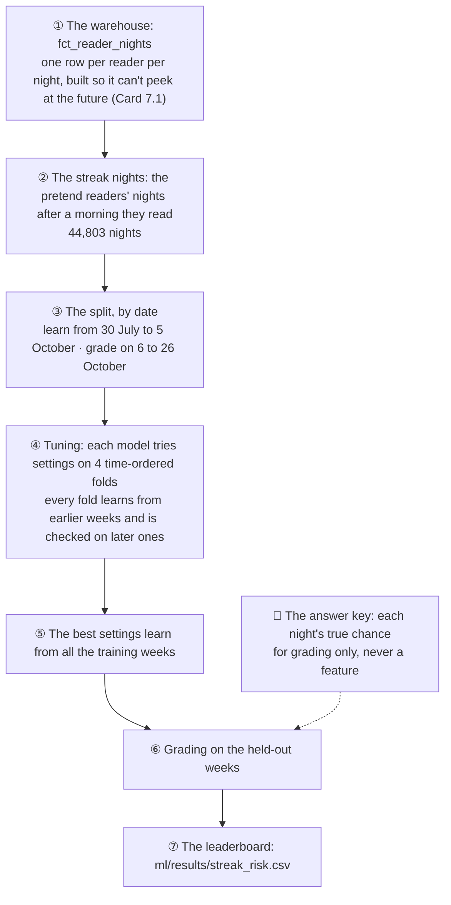
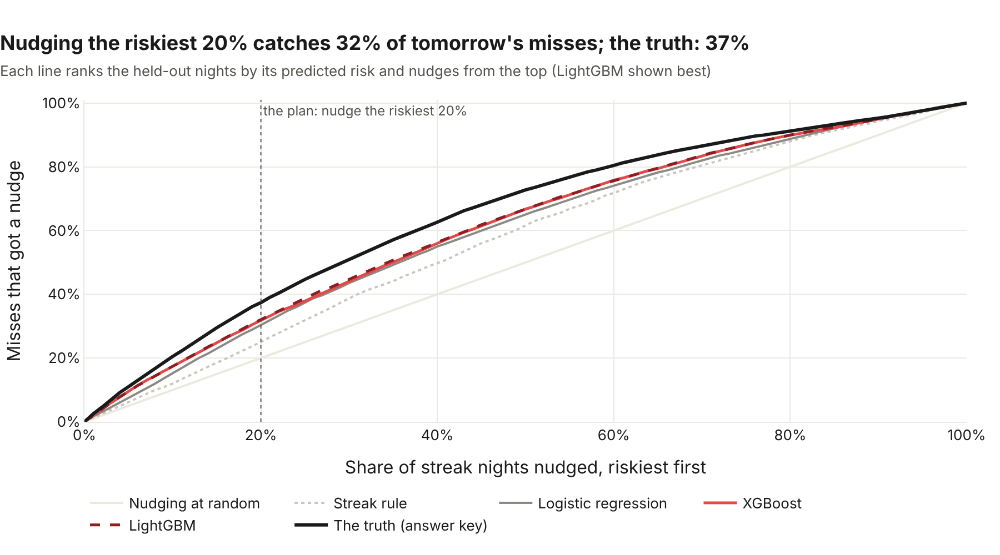
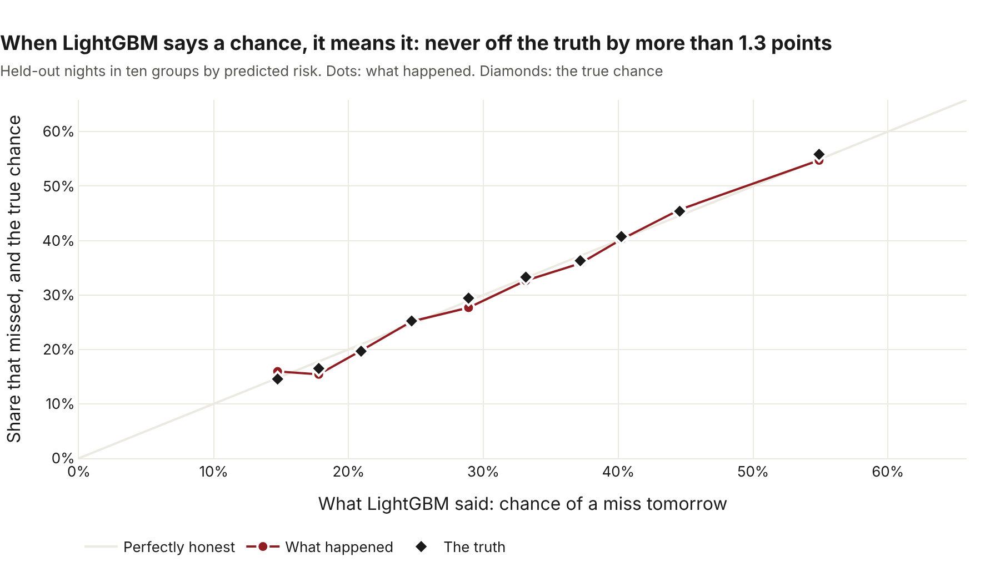

# 🔥 The streak-at-risk model

*Built and graded 4 November 2026 (Card 7.2). The code: [ml/streak_risk.py](../../ml/streak_risk.py).*

Every night, some readers have a streak to protect: they read this morning, and tomorrow morning is still open. If Morning Manna can tell which of them are likely to miss, it can send those readers a gentle nudge, and leave the steady readers in peace.

So the question is: **tonight, how likely is this reader to miss tomorrow morning?**

I trained four models to answer it, from the simplest sensible guess to the workhorses of tabular data. Then I graded them on three weeks they never saw. These are the 5,000 pretend readers from the simulator, so it's a practice run. That has one big advantage: the simulator knows each reader's *true* chance of missing, so I can see how close each model got to perfect knowledge.

## 🏁 The leaderboard: LightGBM, by a whisker

Graded on 22,704 streak nights from 6 to 26 October. 31.3% of them were followed by a missed morning.

| Model | ROC-AUC | PR-AUC | Brier (lower is better) | Nudges that reached a reader who'd miss | Misses that got a nudge | Gap closed |
|---|---|---|---|---|---|---|
| Streak rule | 0.609 | 0.380 | 0.208 | 39.1% | 25.0% | 0% |
| Logistic regression | 0.646 | 0.427 | 0.204 | 47.5% | 30.4% | 33% |
| XGBoost | 0.662 | 0.463 | 0.200 | 49.7% | 31.7% | 48% |
| 🥇 **LightGBM** | **0.665** | **0.464** | **0.199** | **50.2%** | **32.1%** | **50%** |
| *The truth (answer key)* | *0.719* | *0.535* | *0.186* | *58.5%* | *37.4%* | *100%* |

**LightGBM wins on every measure, but only just:** XGBoost is 0.002 behind on ROC-AUC, which is a photo finish. Both trees clearly beat logistic regression, and all three beat the streak rule.

What the winner means in practice: if the app nudges the riskiest fifth of readers each night, **half of those nudges reach someone who would have missed** (against 31% at random), and they cover **a third of all the misses**.


## 🧭 How it was built, step by step



1. **The data comes from the warehouse.** Each night's features use only that night and the days before it, and a dbt test proves it (`reader_nights_never_peek`). The label is whether they missed the next morning.
2. **Only streak nights.** On a night after a missed morning, there's no streak to protect, so those nights aren't part of the question.
3. **The split is by date, not at random.** In real life the model learns from the past and predicts the future. A random split would let it learn from mid-October and then "predict" early October, which flatters every model.
4. **Tuning respects time too.** Each model tries 25 sets of settings (logistic regression has one setting, so it tries 10). Each set is scored on four folds, and every fold learns from earlier weeks only. The score is ROC-AUC.
5. **The winner's settings learn from all the training weeks,** then the model is frozen.
6. **Grading happens once, on the held-out weeks.** The simulator's answer key is attached only here, so no model ever sees it.

## 🤖 The four models, in plain words

- **The streak rule** is a lookup table: of the readers with a 1-day streak, how many missed the next morning? A 2-day streak? It's the baseline every model has to beat, and the kind of rule someone might write by hand.
- **Logistic regression** adds up the features, each with a weight, and turns the total into a chance. It's the classic first try: fast, and easy to explain.
- **XGBoost** and **LightGBM** are gradient-boosted trees. Each builds hundreds of small decision trees, and each new tree fixes the mistakes of the ones before it. They find bends and combinations a straight-line model can't, like "a long streak matters less if their reading time wanders". They grow their trees differently (XGBoost level by level, LightGBM leaf by leaf), which is why it's worth trying both.

## 📏 How they're graded

- **ROC-AUC:** pick one night that ended in a miss and one that didn't. How often does the model call the miss riskier? 0.5 is a coin toss, 1.0 is perfect.
- **PR-AUC:** how precise the model stays as it flags more and more of the misses. It's tougher than ROC-AUC when misses are the smaller group.
- **Brier score:** the average squared gap between the chance given and what happened. It rewards chances that are honest, not just well ranked.
- **The nudge budget:** nudge the riskiest 20% of streak nights. *Precision* is the share of nudges that reached a reader who would have missed. *Recall* is the share of all misses that got a nudge.
- **Gap closed:** how far a model got from the streak rule (0%) to the truth (100%), on ROC-AUC.

## 🎯 Why the truth only scores 0.72

Even perfect knowledge can't see the future. If a reader's true chance of missing tomorrow is 30%, they still flip a weighted coin in the morning. So the truth can't score 1.0, and **0.719 is the ceiling for this data**. That's why "gap closed" is the fairest ruler: it measures each model against what was possible, not against perfection.

The truth also knows things no feature can: how keen each reader secretly is, and whether they're about to drift away for good. The models have to guess those from behaviour. Closing half the gap from guesswork is a good result.



## 🤝 Can its chances be trusted?

A model that ranks well can still give wrong-sized chances. Below, the held-out nights are put into ten groups by LightGBM's chance of a miss. In each group, the dots show the share that missed, and the diamonds show the true chance. **Every group is within 1.3 points of the truth.** When LightGBM says 40%, about 40% miss, so its chances can be used as they are, for example to set a threshold.



## 🔍 What the trees leaned on

Both trees lean hardest on the **read rate over the last 28 days**: a reader's long-run habit says the most about tomorrow. After that they differ. XGBoost leans on the streak length and the last week, while LightGBM leans on how much the reader's reading time wanders. Both point the same way, though: **a steady reader is a safe reader**.

The reminder wording barely matters to either (1 to 4%). The wording's planted effect is small, and it was never meant to drive streaks.


*Gain shows what a model used, not what causes a miss. Two features that carry the same information, like the 7-day and 28-day read rates, can split the credit differently from model to model.*

## 🧪 Tried, and not kept

**How often a reader read on the same weekday in past weeks.** Weekend readers skip weekdays, and commuters dip at weekends, so this sounded promising. It added only **0.003** to the ROC-AUC. The trees already find the pattern from tomorrow's weekday and the read rates, so it stayed out. Fewer features means less to compute every night, and less to go wrong.

## 🤔 What it means, and what it doesn't

- **The trees are worth it here, but not by much.** Going from a straight line to trees closed another 17% of the gap. Between XGBoost and LightGBM, the data can't really choose. LightGBM goes forward because it's ahead on every measure.
- **These are pretend readers.** The practice run proves the whole chain works: the warehouse, the split, the tuning, and the grading. With real readers, I'd run the same code, and there'd be no answer key to compare with, so the streak rule and the held-out weeks become the only rulers.
- **A nudge isn't free.** Half the nudges go to readers who would have read anyway. Whether that's fine depends on how gentle the nudge is, which is a question for the app's nudge (the card after 7.5), and maybe for another A/B test.
- **It's reproducible.** The same warehouse gives the same leaderboard, to the last digit, on every run on the same computer (about 25 seconds).

## ▶️ Run it yourself

From the repo root, after `python ml/simulate.py --end 2026-10-27` and `dbt build`:

```bash
sudo apt install libgomp1                # Linux: LightGBM needs this system library (about 0.4 MB)
pip install -e "ml[models]"              # scikit-learn, xgboost-cpu, LightGBM, … (about 107 MB)
python ml/streak_risk.py                 # trains and grades all four, writes the leaderboard
python ml/streak_risk_charts.py          # the four charts above, as web pages in ml/charts/
```

Every race is also tracked with MLflow, and the winner is registered as a new version of the model. It becomes the `@champion` only if it beats the current one on the same held-out nights ([how it works](../../ml/README.md#-tracking-and-versioning-card-73)). The champion is served by a small web API ([the service](../../ml/README.md#-the-streak-at-risk-service-card-74)), and every night it scores the readers on a streak and flags who gets a nudge ([tonight's scores](../../ml/README.md#-tonights-scores-card-75)).
