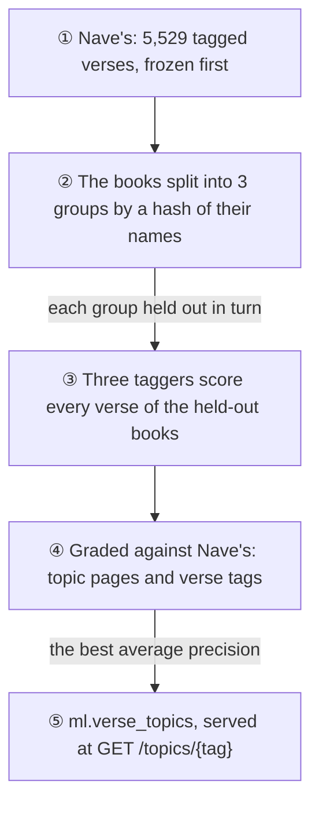
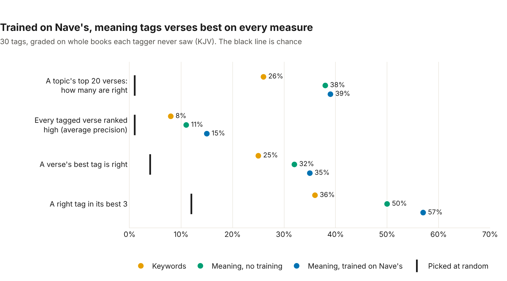
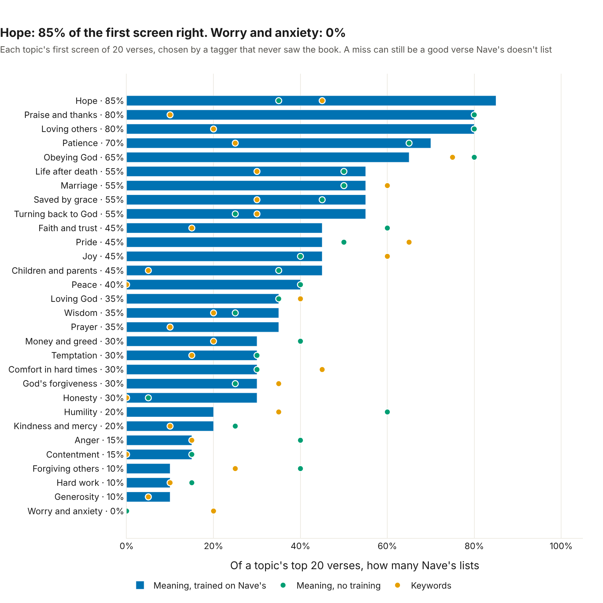

# 🏷️ Topic tags

*Built 5 November 2026 (Card 8.3). The code: [ml/topics.py](../../ml/topics.py); the service: [ml/serve.py](../../ml/serve.py).*

A reader who finishes a passage on patience might want more on patience, and a reader having a hard week might want "comfort in hard times". So every verse now carries **topic tags**, from 30 a reader would recognise: worry and anxiety, comfort, hope, forgiving others, money and greed, patience, marriage, and so on ([ml/data/topic_tags.csv](../../ml/data/topic_tags.csv)).

## 📏 The answer key: Nave's Topical Bible

Tags need an answer key, and a good one already exists. **Nave's Topical Bible** (Orville J. Nave, 1896, public domain) files the Bible's verses under topics: 5,319 subjects in our copy, most with several headings. We use the clean CSV from Brady Stephenson's [BibleData](https://github.com/BradyStephenson/bible-data) (CC BY 4.0).

Each of the 30 tags was mapped to Nave's headings **before any tagger ran**, by rules fixed beforehand:

- **Teaching headings only**, like "General scriptures concerning", "REMEDY FOR" or "OF MAN FOR MAN". Never the story lists ("EXEMPLIFIED", "INSTANCES OF"), whose verses often tell a story without saying the topic, and never the opposite sense ("OF THE WICKED").
- **Only the references on the chosen heading's own line.**
- **A tag needs at least 20 verses.** All 30 have them, from contentment (36) to salvation (494).

The result is [ml/data/topic_key.csv](../../ml/data/topic_key.csv): **5,529 tag-verse pairs over 4,487 verses**. Its fingerprint is checked by a test, so it can't quietly change after results are seen.

## 🏁 The race



Three taggers, each scoring every verse for every tag:

| Tagger | How it decides |
|---|---|
| **Keywords** | The tag's everyday words ("patience patient endure"), found in the verse by Postgres's full-text search |
| **Meaning, no training** | The tag's description ("patience and endurance"), asked as a BGE question, against the verse's vector from 8.1 |
| **Meaning, trained on Nave's** | One logistic regression per tag on the BGE vectors, learning from Nave's examples |

**Graded on books the tagger never saw.** The 66 books split into 3 groups, by a hash of each book's name, and each group is tagged by a model trained on the other two. Every verse gets a score from a tagger that never saw its book, so it can't learn a passage and be tested on the next verse of it. The trained tagger's one setting (scikit-learn's default) was fixed, never tuned.

## 🏆 The results



| Tagger | A topic's top 20: how many right | Average precision | A verse's best tag is right | A right tag in its best 3 |
|---|---|---|---|---|
| Keywords | 26% | 8% | 25% | 36% |
| Meaning, no training | 38% | 11% | 32% | 50% |
| **Meaning, trained on Nave's** | **39%** | **15%** | **35%** | **57%** |
| Picked at random | 1% | 1% | 4% | 12% |

**The trained tagger leads on every measure**, so it's what the app uses, by the rule fixed beforehand (the best average precision). Against meaning without training, it gains **+3.9 points of average precision** (95% interval +0.9 to +7.6, better on 21 of 30 tags). On a topic's first screen of 20 verses, the two are close (+1.3 points, interval −4.8 to +7.5).



## 💡 What we learned

### Some topics shine

**Hope** gets 85% of its first screen right: Romans 8:24, Hebrews 6:19 ("an anchor of the soul"), Romans 15:13. Praise, loving others and patience reach 70–80%. Here's patience's topic page, as the app gets it:

| | Verse |
|---|---|
| James 1:3 | Knowing this, that the trying of your faith worketh patience. |
| 2 Peter 1:6 | And to knowledge temperance; and to temperance patience; and to patience godliness; |
| Romans 5:4 | And patience, experience; and experience, hope: |
| Romans 5:3 | And not only so, but we glory in tribulations also: knowing that tribulation worketh patience; |
| Revelation 14:12 | Here is the patience of the saints: here are they that keep the commandments of God… |

### Worry and anxiety: when the key and the reader mean different things

Worry and anxiety scores **0%**: both meaning taggers miss every one of its 44 verses on the first screen. Looking at the verses explains why. Nave's files worry under *CARE > WORLDLY*: Matthew 6 and Luke 12, about food, clothing and barns. So the trained tagger learned **provision**. Its top verses are about sowing, harvests and "give me neither poverty nor riches", not about worry.

The tagger without training finds what a reader means: James 4:14 ("ye know not what shall be on the morrow"), Deuteronomy 28:66 ("thou shalt fear day and night"). But those aren't in the key, so they score as misses. **Until a better key exists, a reader looking for comfort in worry is better served by search** (Card 8.2: "verses about worry" gives Isaiah 41:10 first). Re-mapping the tag, or choosing the tagger topic by topic, would need a new answer key, written blind, to grade it fairly.

### KJV English has false friends

Both meaning taggers put 2 Peter 1:7 ("to brotherly kindness charity") under generosity. In the KJV, **charity means love**, not giving. Models trained on modern English carry modern meanings.

### Where the books fall matters

Some topics live in a few books: anger mostly in Proverbs, marriage mostly in Genesis. When that book's group is held out, the trained tagger has little to learn from, and the no-training tagger does better (anger 40% against 15%). That's the honest cost of grading on unseen books. An app user's verse can come from a book the model learned little about.

### The scores undercount

Nave's is thorough, but it doesn't list every verse on a topic. Psalm 130:5 ("in his word do I hope") ranks high for hope with the tagger without training, but isn't in the key, so it counts as a miss. As in 8.2, the measured precision is a **lower bound**.

## 🔧 What was built

- **`ml.verse_topics`**: for both translations (the ASV takes the KJV verse's tags by reference), each tag's 500 best verses and each verse's 3 best tags, with the tagger's confidence: **about 191,000 rows** (the exact count moves by a few between computers), replaced in one transaction.
- **`GET /topics`** lists the 30 tags; **`GET /topics/{tag}`** returns a topic's best verses, with their references and text.
- **The whole race takes about 2 minutes**, and needs no new download: it uses 8.1's stored vectors and model.

## ▶️ Run it yourself

From the repo root, with the database up and the verses embedded (`python ml/verse_embeddings.py`):

```bash
python ml/topics.py             # about 2 minutes: the race, the record, and ml.verse_topics
python ml/topics_charts.py      # the two charts above, as web pages in ml/charts/
uvicorn --app-dir ml serve:app --port 8001
curl "http://localhost:8001/topics/patience?k=5"
```

`python ml/topics.py --build-key` rebuilds the answer key from Nave's (it downloads the 1.4 MB CSV into `data/raw/` once, and checks its md5 first); the committed key must come out identical.

*Nave's Topical Bible data: Brady Stephenson, BibleData (2026), [doi.org/10.5281/zenodo.19539956](https://doi.org/10.5281/zenodo.19539956), CC BY 4.0.*
