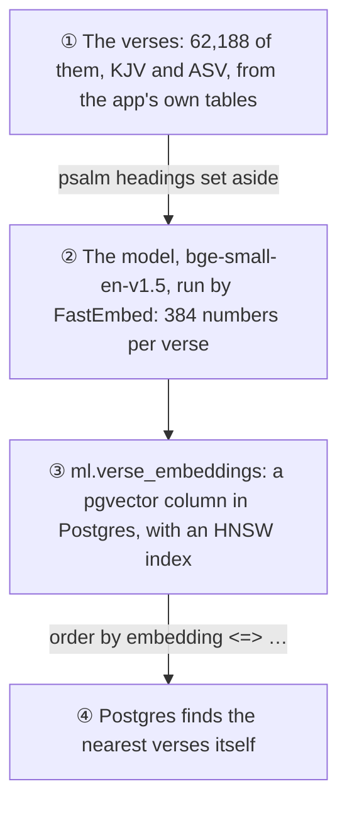

# 🧬 Verse embeddings

*Built 5 November 2026 (Card 8.1). The code: [ml/verse_embeddings.py](../../ml/verse_embeddings.py).*

Phase 8 gives Morning Manna a smarter reading experience: search by meaning, topic tags, and "because you read Psalm 23…". All of it rests on one step, taken in this card: **turning every verse into a vector of its meaning.**

A sentence-transformer model reads a verse and gives back 384 numbers. Verses that mean similar things get vectors that point the same way, even when they share no words. So "fear not" and "be not afraid" end up close, and a search for "verses about worry" can find "take no thought for the morrow" (Card 8.2).

## 🔧 What was built



- **The model** is BAAI's `bge-small-en-v1.5`, one of the best small sentence-transformer models for search. It runs through **FastEmbed** on ONNX Runtime, which needs no PyTorch: **33 MB** of libraries instead of about 2 GB (PyTorch on Linux brings its GPU libraries along). The model itself is **67.5 MB**, downloaded once.
- **Postgres stores the vectors** with **pgvector**, which adds a `vector` column type and a distance operator (`<=>`, cosine distance). The database image becomes `pgvector/pgvector:pg16`, the official Postgres 16 with pgvector added, so existing data carries over.
- **An HNSW index** (a graph of neighbours) lets Postgres find the nearest vectors without comparing against all 62,188 of them. It's approximate, which is the price of speed; Card 8.2 measures whether it matters.
- **Only new verses are embedded.** The first run embeds everything (about 6 to 8 minutes on 4 cores); after that, a run takes seconds.
- **Shortest verses first.** Verses are embedded in batches, and each batch is padded to its longest verse. Sorting by length first made it **1.7 times faster** (97 → 166 verses a second here).

## 🔍 Is it any good?

There's no answer key for meaning yet (Card 8.2 brings labelled questions). But the Bible has a structure the model never saw: its sections, from the Law to Revelation. If the vectors capture meaning, a verse's nearest neighbours should mostly come from the same section, and chapters should cluster by section.


**On 2,000 KJV verses, 62% of the five nearest neighbours come from the same section, against 17% by chance.** And 34% come from the very same book, against 3% by chance. Every section beats chance by a wide margin; the prophets and the letters, whose themes spread widest, the least.


Averaged by chapter, the structure is plain: the letters, the gospels, the poetry, the prophets and the histories each gather in their own region. Revelation sits between the prophets and the gospels, which is about where a reader would put it.

## 🐑 A finding: the psalms' headings

The first run gave Psalm 23:1 ("The Lord is my shepherd") three neighbours that had nothing to do with shepherds: Psalms 26:1, 29:1 and 101:1. The reason was in the data, not the model. In this Bible's text, **each psalm's heading is part of verse 1**: "A Psalm of David. The Lord is my shepherd; I shall not want." The model was matching headings to headings.

So psalm headings are set aside before embedding: 115 in the KJV and 116 in the ASV, each one read by eye. **The text readers see doesn't change.** Now Psalm 23:1's nearest neighbour is Ezekiel 34:10, from the Bible's other great shepherd chapter. One heading is left in, Psalm 18's in the KJV, because it runs straight into the verse ("…and he said, I will love thee, O Lord") and there's no clean place to cut.

## 🤔 What it means, and what it doesn't

- **It works best where verses carry content.** John 3:16's nearest neighbours are 1 John 4:9 ("God sent his only begotten Son into the world") and John 3:15: exactly right. Short verses about God's commands blur together, and Matthew 6:34 ("take no thought for the morrow") finds verses that share its old wording ("therefore", "the day") more than its meaning.
- **The KJV's English is far from what the model learned on**, which was modern web text. Card 8.2 will measure search on labelled questions, and can then compare the KJV with the ASV, and this model with others, honestly.
- **Section agreement isn't the goal**, only a check that needs no labels. A verse about mercy in the prophets *should* sit near one in the letters; search will be graded on whether it finds what a reader asked for.

## ▶️ Run it yourself

From the repo root, with the database up (`docker compose up -d db`):

```bash
python ml/verse_embeddings.py           # the first time: about 6 to 8 minutes, plus the 67.5 MB model
python ml/verse_embeddings_charts.py    # the two charts above, as web pages in ml/charts/
```
