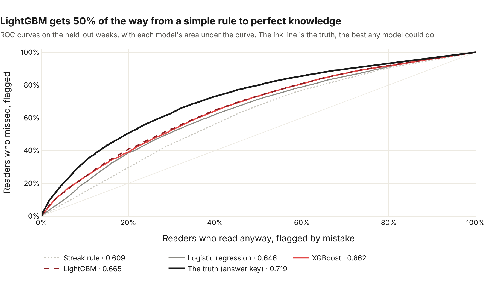

# Morning Manna ML

Pretend readers, the answer key the models are graded against, and the models themselves. The first one, streak risk, is built; reader personas and the best reminder time are next in Card 7.

Python 3.11+ · NumPy · scikit-learn · XGBoost · LightGBM

## Pretend readers

There are no real users yet, so the pipelines, the warehouse and the models need practice data. [simulate.py](simulate.py) makes it, with habits that look like people's:

| Persona | Share | Habit |
|---|---|---|
| Early riser | 35% | Wakes around 05:15 and reads soon after, almost every day |
| Commuter | 40% | Reads on the way to work; dips at weekends |
| Weekend reader | 25% | Reads most on Saturdays and Sundays |

Readers live in five time zones (Lagos, New York, London, Manila and Chicago). Their streaks break, and some drift away for good.

**The reminder experiment.** A fair coin puts each reader in group A or B of the [reminder test](../docs/analysis/reminder-experiment.md), and wording B carries a planted effect: readers in group B whose reminders are on are a little likelier to read each morning. It's the practice run's answer key. The analysis never reads it, and is checked against it only once it's done. The coin has a random stream of its own, so group A readers live exactly the mornings they did before the experiment existed.

[true_effect.py](true_effect.py) opens the answer key: it simulates the same readers twice, with the effect and without it, to measure what the effect is truly worth on day-7 return (**+5.9 points** in one long run; the 1,200-run drill in [analytics/experiments/drill.py](../analytics/experiments/drill.py) pins it to **+5.5**). It was run only after the analysis's verdict was merged. From the repo root, it takes about a minute:

```bash
python ml/true_effect.py
```

Every reader and event is marked `synthetic`, and none of it goes near the app's own tables.

```bash
# From the repo root
python ml/simulate.py                       # 5,000 readers, the 90 days up to yesterday
python ml/simulate.py --end 2026-10-27      # the same days every time
python ml/simulate.py --readers 200 --days 30 --seed 3
```

The same seed (7 by default) and the same end date always make exactly the same readers. That's how CI and two different computers can check each other to the last event. With `--end 2026-10-27`: 5,000 readers, 179,077 events, and an answer key of 151,664 reader-days.

It writes a small data lake, laid out the way the S3 bucket holds it:

```
data/lake/readers/synthetic.jsonl                one line per reader
data/lake/events/dt=2026-10-27/synthetic.jsonl   one line per event, filed by the day it arrived
```

Then [pipelines/README.md](../pipelines/README.md#the-loader) uploads and loads it.

## 🔑 The answer key (Card 7)

Each morning, the simulator knows each reader's **true chance of finishing a reading**: whether they stay (some leave for good, most likely in their first days), how keen they still are, their weekday habit, their streak, and their reminder wording. It saves that chance for every reader-day, apart from the lake:

```
data/answer_key/finish_chance.csv.gz             user_key, day, finish_chance
```

It never goes into the warehouse, so the models in Card 7 can't see it. They're graded against it afterwards, the way the A/B test's verdict was. Saving it draws no random numbers, so the lake comes out byte for byte the same as before it existed (a test checks).

The first thing it graded was the warehouse itself. [Notebook 03](../analytics/notebooks/03_streak_risk_data.ipynb) puts each night's label next to the truth about the next morning, and they agree: **70.40%** of nights were followed by a miss, against **70.40%** expected, and so on down every streak length.


## 🔥 The streak-at-risk model (Card 7.2)

Tonight, how likely is a reader on a streak to miss tomorrow morning? [streak_risk.py](streak_risk.py) trains four models to answer it, from the warehouse's `fct_reader_nights`: a streak-length lookup (the baseline), logistic regression, XGBoost and LightGBM. Each is tuned on time-ordered folds, so no model learns from its own future, then graded once on the last three weeks, against the answer key.

| Model | ROC-AUC | Nudge the riskiest 20%: misses caught | Gap closed |
|---|---|---|---|
| Streak rule | 0.609 | 25.0% | 0% |
| Logistic regression | 0.646 | 30.4% | 33% |
| XGBoost | 0.662 | 31.7% | 48% |
| 🥇 **LightGBM** | **0.665** | **32.1%** | **50%** |
| *The truth (answer key)* | *0.719* | *37.4%* | *100%* |

"Gap closed" is how far each model got from the streak rule to perfect knowledge. Even the truth can't score 1.0, because a reader with a 30% chance of missing still flips a weighted coin in the morning. The whole story, with four charts: [the write-up](../docs/analysis/streak-risk-model.md).



```bash
# From the repo root, after simulate.py and dbt build
sudo apt install libgomp1           # Linux: LightGBM needs this system library (about 0.4 MB)
pip install -e "ml[models]"         # scikit-learn, xgboost-cpu, LightGBM, … (about 107 MB)
python ml/streak_risk.py            # about 25 seconds; writes ml/results/streak_risk.csv
python ml/streak_risk_charts.py     # the charts, as web pages in ml/charts/
```

The libraries are an extra, so the simulator stays light for the jobs that only need it. LightGBM uses the system's OpenMP library to train on several cores, and a minimal Ubuntu (WSL's, for one) doesn't have it: without `libgomp1`, `import lightgbm` fails with `libgomp.so.1: cannot open shared object file`. scikit-learn and XGBoost bring their own copy. On a Mac, it's `brew install libomp`. `xgboost-cpu` is XGBoost without the 291 MB of GPU libraries the full package brings, which nothing here uses. The same warehouse gives the same leaderboard to the last digit, on every run on the same computer.

## Tests

```bash
cd ml
pip install -e ".[dev,models]"
pytest          # 35 tests
```
