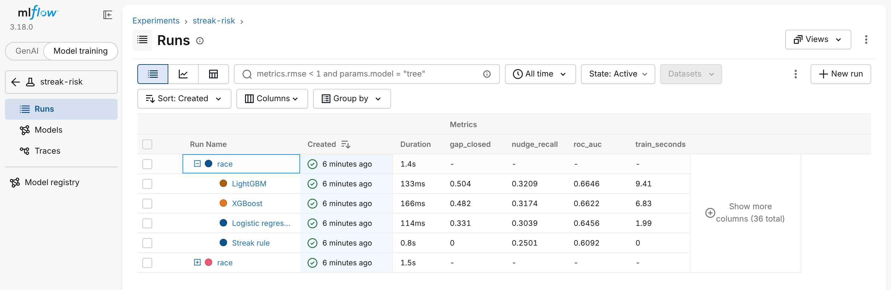
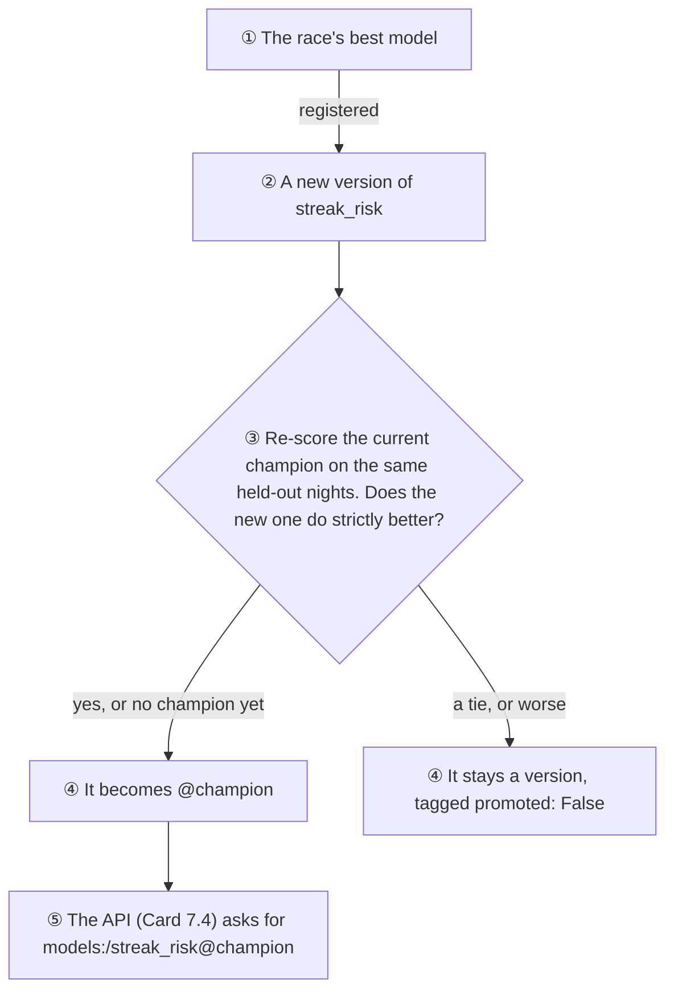
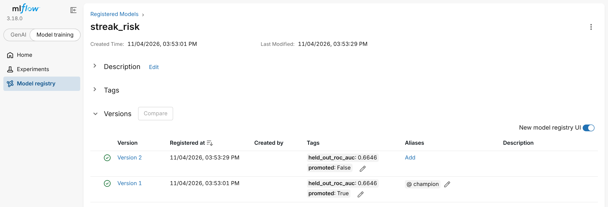
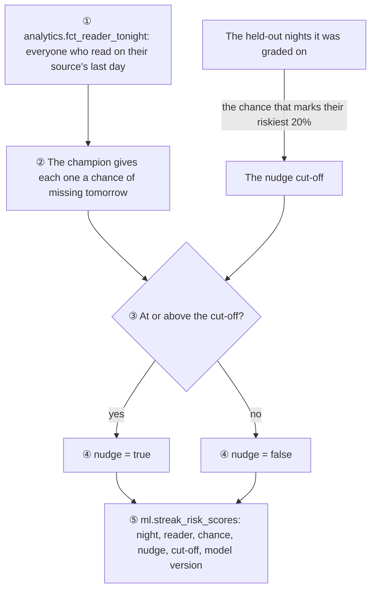
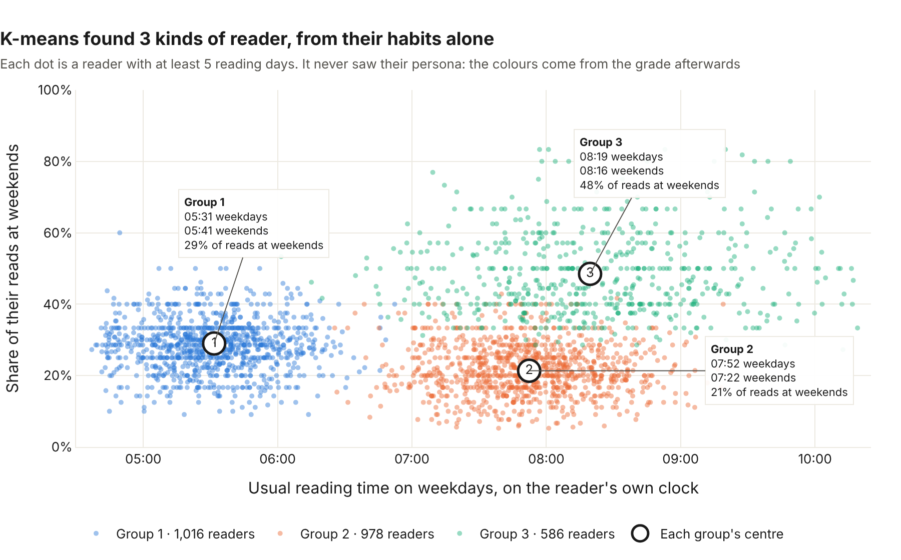
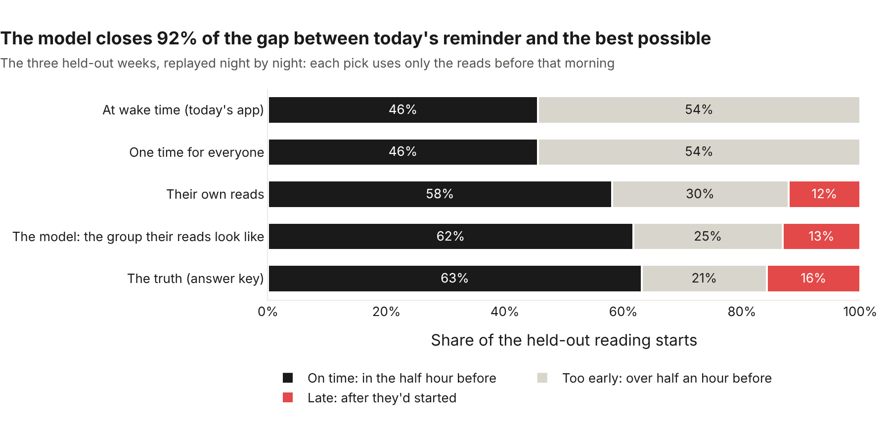
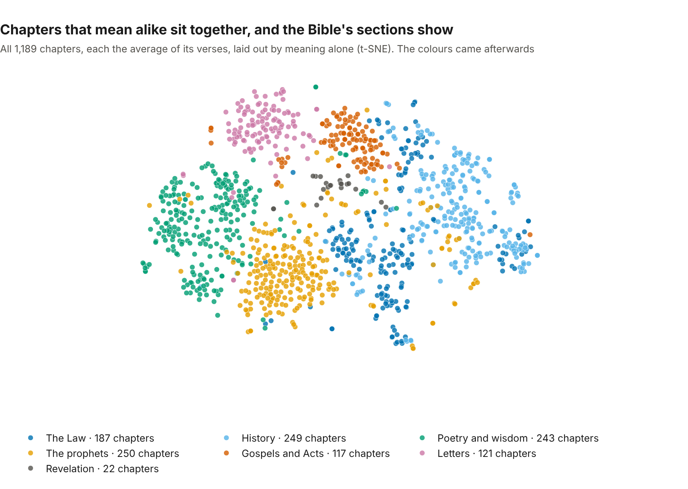
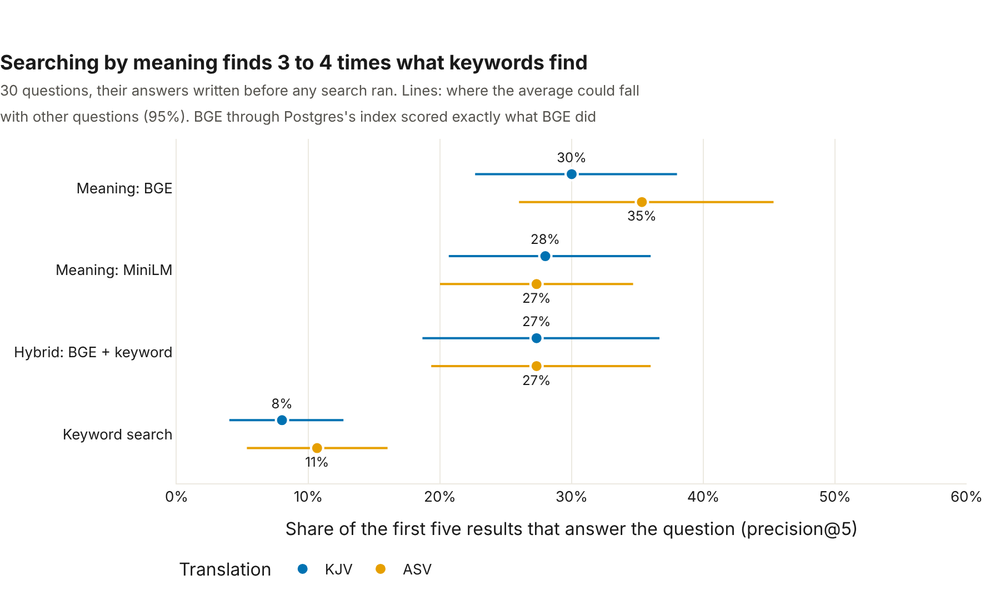
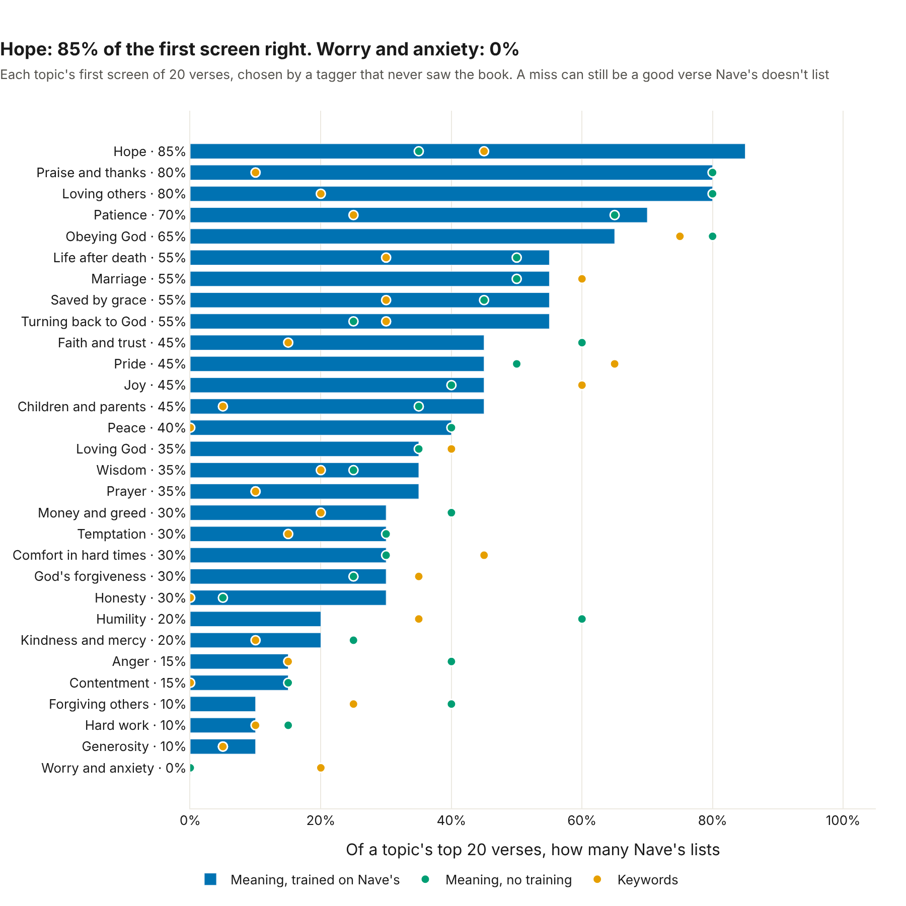
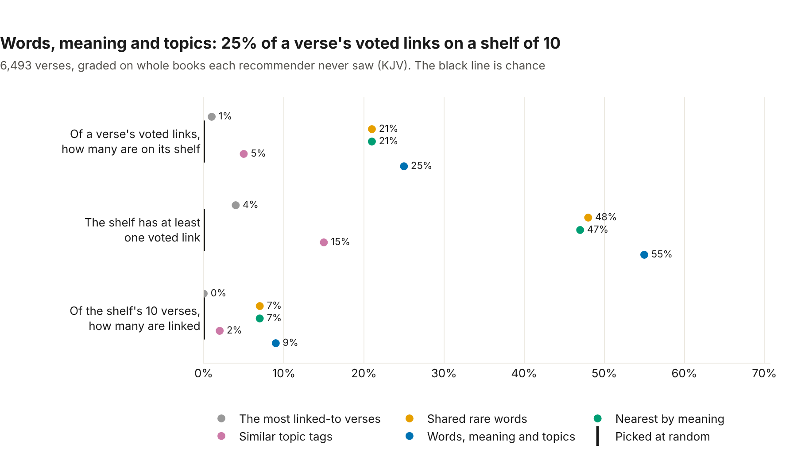

# Morning Manna ML

Pretend readers, the answer key the models are graded against, and the models themselves. Card 7 built three: streak risk, reader personas and the best reminder time. Card 8 adds language: every verse as a vector of its meaning, search by meaning, topic tags, and what to read next.

Python 3.11+ · NumPy · scikit-learn · XGBoost · LightGBM · MLflow · FastEmbed · pgvector

## Pretend readers

There are no real users yet, so the pipelines, the warehouse and the models need practice data. [simulate.py](simulate.py) makes it, with habits that look like people's:

| Persona | Share | Habit |
|---|---|---|
| Early riser | 35% | Wakes around 05:15 and reads soon after, almost every day |
| Commuter | 40% | Reads on the way to work; dips at weekends |
| Weekend reader | 25% | Reads most on Saturdays and Sundays |

Readers live in five time zones (Lagos, New York, London, Manila and Chicago). Their streaks break, and some drift away for good.

**The reminder experiment.** A fair coin puts each reader in group A or B of the [reminder test](../docs/analysis/reminder-experiment.md), and wording B carries a planted effect: readers in group B whose reminders are on are a little likelier to read each morning. It's the practice run's answer key. The analysis never reads it, and is checked against it only once it's done. The coin has a random stream of its own, so group A readers live exactly the mornings they did before the experiment existed.

[true_effect.py](true_effect.py) opens the answer key: it simulates the same readers twice, with the effect and without it, to measure what the effect is truly worth on day-7 return (**+5.9 points** in one long run; the 1,200-run drill in [analytics/experiments/drill.py](../analytics/experiments/drill.py) pins it to **+5.5**). It was run only after the analysis's verdict was merged. From the repo root, it takes about a minute:

```bash
python ml/true_effect.py
```

Every reader and event is marked `synthetic`, and none of it goes near the app's own tables.

```bash
# From the repo root
python ml/simulate.py                       # 5,000 readers, the 90 days up to yesterday
python ml/simulate.py --end 2026-10-27      # the same days every time
python ml/simulate.py --readers 200 --days 30 --seed 3
```

The same seed (7 by default) and the same end date always make exactly the same readers. That's how CI and two different computers can check each other to the last event. With `--end 2026-10-27`: 5,000 readers, 179,077 events, and an answer key of 151,664 reader-days.

It writes a small data lake, laid out the way the S3 bucket holds it:

```
data/lake/readers/synthetic.jsonl                one line per reader
data/lake/events/dt=2026-10-27/synthetic.jsonl   one line per event, filed by the day it arrived
```

Then [pipelines/README.md](../pipelines/README.md#the-loader) uploads and loads it.

## 🔑 The answer key (Card 7)

Each morning, the simulator knows each reader's **true chance of finishing a reading**: whether they stay (some leave for good, most likely in their first days), how keen they still are, their weekday habit, their streak, and their reminder wording. It saves that chance for every reader-day, apart from the lake:

```
data/answer_key/finish_chance.csv.gz             user_key, day, finish_chance
```

It never goes into the warehouse, so the models in Card 7 can't see it. They're graded against it afterwards, the way the A/B test's verdict was. Saving it draws no random numbers, so the lake comes out byte for byte the same as before it existed (a test checks).

The first thing it graded was the warehouse itself. [Notebook 03](../analytics/notebooks/03_streak_risk_data.ipynb) puts each night's label next to the truth about the next morning, and they agree: **70.40%** of nights were followed by a miss, against **70.40%** expected, and so on down every streak length.


## 🔥 The streak-at-risk model (Card 7.2)

Tonight, how likely is a reader on a streak to miss tomorrow morning? [streak_risk.py](streak_risk.py) trains four models to answer it, from the warehouse's `fct_reader_nights`: a streak-length lookup (the baseline), logistic regression, XGBoost and LightGBM. Each is tuned on time-ordered folds, so no model learns from its own future, then graded once on the latest three weeks of nights (on the practice run, from 2026-10-06), against the answer key.

| Model | ROC-AUC | Nudge the riskiest 20%: misses caught | Gap closed |
|---|---|---|---|
| Streak rule | 0.609 | 25.0% | 0% |
| Logistic regression | 0.646 | 30.4% | 33% |
| XGBoost | 0.662 | 31.7% | 48% |
| 🥇 **LightGBM** | **0.665** | **32.1%** | **50%** |
| *The truth (answer key)* | *0.719* | *37.4%* | *100%* |

"Gap closed" is how far each model got from the streak rule to perfect knowledge. Even the truth can't score 1.0, because a reader with a 30% chance of missing still flips a weighted coin in the morning. The whole story, with four charts: [the write-up](../docs/analysis/streak-risk-model.md).


```bash
# From the repo root, after simulate.py and dbt build
sudo apt install libgomp1           # Linux: LightGBM needs this system library (about 0.4 MB)
pip install -e "ml[models]"         # scikit-learn, xgboost-cpu, LightGBM, … (about 107 MB)
python ml/streak_risk.py            # about 40 seconds; writes ml/results/streak_risk.csv (TUNING_JOBS=-1 tunes on every core)
python ml/streak_risk_charts.py     # the charts, as web pages in ml/charts/
```

The libraries are an extra, so the simulator stays light for the jobs that only need it. LightGBM uses the system's OpenMP library to train on several cores, and a minimal Ubuntu (WSL's, for one) doesn't have it: without `libgomp1`, `import lightgbm` fails with `libgomp.so.1: cannot open shared object file`. scikit-learn and XGBoost bring their own copy. On a Mac, it's `brew install libomp`. `xgboost-cpu` is XGBoost without the 291 MB of GPU libraries the full package brings, which nothing here uses. The same warehouse gives the same leaderboard to the last digit, on every run on the same computer.

## 📒 Tracking and versioning (Card 7.3)

A model on its own is just a file. [model_registry.py](model_registry.py) writes down how each one came to be, with **MLflow**: every race becomes a run with the charts and the leaderboard, and each model gets a run of its own, with its settings, its scores, the libraries it needs, and the model itself.



Then the race's best model is registered as a new version of `streak_risk`, and it has to earn the **`@champion`** alias:





The champion is re-scored rather than trusted from its old tag, so the comparison stays fair when the data moves on. A tie keeps the old champion: a new model has to be better, not just as good.

```bash
# From the repo root, after dbt build
pip install -e "ml[models,tracking]"     # MLflow, about 113 MB more
python ml/model_registry.py              # trains, tracks and registers (a little longer than streak_risk.py)

# Then look around, at http://localhost:5000
MLFLOW_DISABLE_TELEMETRY=true mlflow ui --backend-store-uri sqlite:///ml/mlruns/mlflow.db
```

- **Where it lives:** a SQLite file and the saved models in `ml/mlruns/`, which git ignores. The models' versions live in the registry, not in git. Setting `MLFLOW_TRACKING_URI` sends everything to an MLflow server instead, with no code change.
- **Safe to load:** MLflow saves scikit-learn models with **skops**, not pickle. Pickle runs whatever code a file contains, so a tampered model could do anything. skops rebuilds only the types it's told to trust, and each model trusts just the few it needs (`TRUSTED`).
- **Nothing leaves the machine:** MLflow 3 sends usage statistics to its makers by default. `model_registry.py` switches that off, and so does `MLFLOW_DISABLE_TELEMETRY=true` in front of `mlflow ui`.
- **Loaded back exactly:** every run checks that the registered model predicts exactly what it did before it was saved.

## 🔔 The streak-at-risk service (Card 7.4)

[serve.py](serve.py) puts the champion behind a small web API. It loads `models:/streak_risk@champion` when it starts, and anything that can send JSON (the nightly scoring in Card 7.5, the app, or you) can ask it about tonight's readers.

| Endpoint | What it answers |
|---|---|
| `GET /health` | Is it up, and is a model loaded? |
| `GET /model` | Which version is serving, and how it scored on held-out nights |
| `POST /streak-risk` | For up to 1,000 streak nights at once, each reader's chance of missing tomorrow, and which version said so |
| `GET /search` | The verses that answer a question, by meaning (Card 8.2, [below](#-semantic-search-card-82)) |
| `GET /topics`, `GET /topics/{tag}` | The 30 topic tags, and a topic's best verses (Card 8.3, below) |
| `GET /because-you-read` | After a verse, a chapter or a passage, the 10 verses a reader might want next (Card 8.4, below) |


```bash
# From the repo root, after python ml/model_registry.py has crowned a champion
pip install -e "ml[models,tracking,serving]"
uvicorn --app-dir ml serve:app --port 8001      # then open http://localhost:8001/docs
```

- **It speaks the reader's language.** Callers send `"reminder_variant": "B"`, not the model's `wording_b = 1`. The service translates, and always builds the exact columns the model learned from.
- **Impossible nights are refused** with a clear error (422) before the model sees them: a rate above 100%, an 8th weekday, a streak of 0, a third wording, or a misspelled field.
- **It says exactly what the model says.** A test sends 300 held-out nights through the API and checks every answer against the model run directly, to the last digit.
- **Every answer is traceable:** it names the model version that gave it.
- **No champion yet?** It still starts, and says so plainly (503, with what to run) instead of crashing.
- **It's its own service, apart from the app's API in `backend/`,** so the app never carries the model libraries (over 200 MB), and either one can be restarted without the other. It checks the registry for a new champion every 10 minutes at most, and swaps it in with no restart.
- **It's quick:** a batch of 1,000 nights takes about 20 milliseconds.

## 🌙 Tonight's scores (Card 7.5)

Every night, some readers have a streak to protect. [score_tonight.py](score_tonight.py) asks the champion about each of them and decides who gets a gentle nudge:



```bash
# From the repo root, after dbt build, once a champion is crowned
python ml/score_tonight.py
```

- **One feature recipe.** Tonight's features come from `int_reader_nights`, the same dbt model the training table reads from, so the numbers the model is asked about are worked out exactly the way the ones it learned from were.
- **A fixed cut-off, not a quota.** The cut-off comes from the held-out nights the model was graded on (Card 7.2): the chance that marks their riskiest fifth, about 42% for the current champion. Rehearsal caught the quota's flaw: "the riskiest fifth" of a single real reader is nobody, so a lone reader at 56% would never have been nudged. With a cut-off, the rule is the same for one reader or 10,000, and a calm night nudges fewer people than a shaky one.
- **Every row is traceable:** the chance, the cut-off it was compared with, and the model version that gave it.
- **Safe to re-run.** Scoring a night again replaces its scores in one transaction: all of them land, or none do.
- **Its own schema.** The scores live in `ml`, apart from the app's tables (`public`), the loader's (`raw`) and dbt's (`analytics`).

Airflow runs it every night after dbt (`daily_events`, Card 9), asking the MLflow server for the champion. You can still run it by hand.

## 🧭 Reader personas (Card 7.6)

Can a model find the kinds of reader from their habits alone? [personas.py](personas.py) gives K-means four habits from the warehouse's `fct_reader_habits` (weekday reading time, weekend reading time, the share of reads at weekends, and how much the reading time wanders), and never the persona. It chooses the number of groups itself, then is graded against the simulator's true personas on readers it never saw.



**It found them: 3 groups, ARI 0.91** (1 is a perfect match, 0 is chance). It even found that commuters read earlier at weekends. The whole story, with the honest split and the three charts: [the write-up](../docs/analysis/reader-personas.md).

```bash
# From the repo root, after dbt build
python ml/personas.py            # a few seconds; writes ml/results/personas.csv and ml.reader_personas
python ml/personas_charts.py     # the charts, as web pages in ml/charts/
```

- **The persona is the answer key.** It's read only to grade, the way the A/B test's planted effect was, and a test checks the habits table never carries it.
- **Chosen on one half, graded on the other.** Readers are split by a hash of their key: the number of groups and the groups themselves come from the learning half, and the grade from the checking half.
- **At least 5 reading days**, a weekday and a weekend one among them, or a habit is mostly noise (ARI 0.59 for readers with 2 to 4). That's 52% of the pretend readers for now.

## ⏰ The best reminder time (Card 7.7)

The app sends the morning reminder at the reader's wake time. That suits early risers, but commuters start reading over an hour later, on the train. [reminder_time.py](reminder_time.py) learns how long after waking each reader usually starts, on weekdays and at weekends, from the warehouse's `fct_reader_starts`, and picks the time most likely to land in the half hour before they start.



**It closes 92% of the gap** between today's reminder (46% on time) and the best possible (63%). For commuters on weekdays, on time goes from 1% to 51%. It can't show that better timing makes people read more: in the simulator, timing changes nothing, so that needs an experiment with real readers. The whole story: [the write-up](../docs/analysis/reminder-time.md).

```bash
# From the repo root, after dbt build and python ml/personas.py
python ml/reminder_time.py           # a few seconds; writes ml/results/reminder_time.csv and ml.reminder_times
python ml/reminder_time_charts.py    # the charts, as web pages in ml/charts/
```

- **Built on Card 7.6.** Each group has its usual gaps after waking; a reader's own reads say which group they look like (Bayes' rule), and one or two reads are usually enough.
- **Replayed night by night.** It's graded on the streak model's three held-out weeks, and each morning's pick uses only the reads before it.
- **When unsure, the safe time.** A reader with no history gets the time most likely to be right, not an average of the groups: that's their wake time.

## 🧬 Verse embeddings (Card 8.1)

Phase 8's search, topic tags and recommendations all rest on one step: turning every verse into a vector of its meaning. [verse_embeddings.py](verse_embeddings.py) runs the sentence-transformer model `bge-small-en-v1.5` through FastEmbed (ONNX, no PyTorch) over all 62,188 verses, and stores the 384-number vectors in Postgres with pgvector (`ml.verse_embeddings`, with an HNSW index), so Postgres itself can find the nearest verses.



**A verse's five nearest neighbours share its section of the Bible 62% of the time, against 17% by chance**, though the model never saw the sections. The whole story, including why the psalms' headings are left out of the vectors: [the write-up](../docs/analysis/verse-embeddings.md).

```bash
# From the repo root, with the database up
pip install -e "ml[nlp]"                  # about 33 MB; the model (67.5 MB) downloads on first use
python ml/verse_embeddings.py             # the first time 6 to 8 minutes; then only new verses
python ml/verse_embeddings_charts.py      # the charts, as web pages in ml/charts/
```

- **Postgres needs pgvector.** `docker compose` runs `pgvector/pgvector:pg16`, the official Postgres 16 with pgvector added, so existing data carries over.
- **No PyTorch.** FastEmbed runs the same model on ONNX Runtime: about 33 MB of libraries instead of about 2 GB.
- **The tests never download the model.** A stand-in encoder tests everything around it; the storage tests need the database (`docker compose up -d db`).

## 🔎 Semantic search (Card 8.2)

A reader asks in their own words, and [search.py](search.py) finds the verses that answer, even when they share no words: "verses about worry" finds "Fear thou not; for I am with thee". The question becomes a vector with 8.1's model, and Postgres's HNSW index finds the nearest verses.



**Searching by meaning finds three to four times what keyword search finds**, graded on 30 questions whose answers were written, and frozen, before any search ran. Five methods raced on both translations; BGE, the model 8.1 stored, won, and the hybrid of meaning and keywords did no better. The whole story: [the write-up](../docs/analysis/semantic-search.md).

```bash
# From the repo root, with the database up and the verses embedded
python ml/search.py              # the race: about 5 minutes (MiniLM's 90 MB downloads the first time)
python ml/search_charts.py       # the charts, as web pages in ml/charts/
uvicorn --app-dir ml serve:app --port 8001
curl "http://localhost:8001/search?q=verses+about+worry&k=5"
```

- **The answer key is frozen.** [data/search_questions.csv](data/search_questions.csv) was written before any search ran, and a test checks its fingerprint: tuning to 30 questions would grade the search on itself.
- **`/search` lives in the ML service,** next to the streak-risk endpoints. It loads the model on the first search, and without the `nlp` extra or the verse vectors it says what to run (503) while the rest carries on.
- **It never comes back short.** The index gathers candidates from both translations before filtering to one, so it weighs 100 candidates, and if that's still too few, reads every verse instead.
- **The records:** `results/search.csv` (the leaderboard, whole percents) and `results/search_by_question.csv` (every question's grades, which the charts read).

## 🏷️ Topic tags (Card 8.3)

Every verse is tagged with what it's about, from 30 topics a reader would recognise: hope, patience, comfort in hard times, forgiving others, money and greed, and more. [topics.py](topics.py) races three taggers and stores the winner's tags in `ml.verse_topics`, for topic pages in the app.



**The answer key is Nave's Topical Bible** (1896, public domain; the CSV from [BibleData](https://github.com/BradyStephenson/bible-data), CC BY 4.0). Each tag was mapped to Nave's teaching headings before any tagger ran, giving 5,529 tags on 4,487 verses. **A logistic regression on the BGE vectors wins every measure**, graded on whole books it never saw. Worry and anxiety fails, because Nave's files it under worldly care (food, clothing, barns), and the write-up shows why. The whole story: [the write-up](../docs/analysis/topic-tags.md).

```bash
# From the repo root, with the database up and the verses embedded
python ml/topics.py              # about 2 minutes: the race, the record, and ml.verse_topics
python ml/topics_charts.py       # the charts, as web pages in ml/charts/
curl "http://localhost:8001/topics/patience?k=5"     # with the service running
```

- **The tags and the key are frozen.** [data/topic_tags.csv](data/topic_tags.csv) and [data/topic_key.csv](data/topic_key.csv) were fixed before any tagger ran, and a test checks both fingerprints. `python ml/topics.py --build-key` rebuilds the key from Nave's (1.4 MB, downloaded once into `data/raw/`, md5 checked) and must reproduce it exactly.
- **Graded on unseen books.** The books split into 3 groups by a hash of their names; every verse is scored by a tagger trained on the other groups.
- **No new download.** It uses 8.1's stored vectors and model.
- **The records:** `results/topics.csv` (the leaderboard, whole percents) and `results/topics_by_tag.csv` (each tag's grades, also whole percents, which the charts read). Whole percents because another computer's floating point can move a 4th decimal.

## 📚 Because you read (Card 8.4)

After a passage, a shelf of 10 verses to read next, each from a different chapter and never from the chapter just read. [recommend.py](recommend.py) races five recommenders and stores every verse's shelf in `ml.verse_shelves`; a passage pools its verses' shelves.



**The answer key is OpenBible.info's cross-references** (CC BY): 344,799 links between verses, voted on by readers. A link counts from 10 votes, the best tenth, and the rules were fixed before any recommender ran. **The blend of shared words, meaning and topic tags wins**, graded on whole books it never saw: it finds 25% of a verse's voted links, against 21% for words or meaning alone. The whole story: [the write-up](../docs/analysis/because-you-read.md).

```bash
# From the repo root, with the database up, the verses embedded and the topics tagged
python ml/recommend.py           # about 4 minutes: the race, the records, and ml.verse_shelves
python ml/recommend_charts.py    # the charts, as web pages in ml/charts/
curl "http://localhost:8001/because-you-read?book=John&chapter=3&verse=16&k=5"
```

- **The key is the published file, pinned.** It downloads once (8.3 MB, into `data/raw/`) and its md5 is checked, so a changed file can't quietly change the grades.
- **Graded on unseen books,** in 8.3's 3 groups. The only things learned from the key (how often each verse is linked to, and the blend's weights) come from the other groups.
- **Passages were graded too,** on every run of 6 verses: adding up the verses' shelf scores beat fusing their ranks, and beat the whole passage as one query.
- **Readers like you is built and switched off.** Everyone reads the same plan, so readers' choices say nothing yet; `collab_status` turns it on once 200 readers have each chosen 5 chapters themselves.
- **The records:** `results/shelves.csv` (the leaderboard), `shelves_by_section.csv`, `shelves_weights.csv` and `shelves_passages.csv`, all whole percents or counts. With the vectors nudged by another computer's rounding, the blend's weights for one book group can swap with a neighbour 0.04 points behind, moving a few numbers by a point, so another computer's records match within a point, not byte for byte.

## 🐳 The model registry in Docker (Card 9)

`docker compose up -d --build` now runs the models' whole life by itself: the MLflow server keeps the registry, Airflow retrains every Sunday and scores every night, and the ML service serves whichever version is `@champion`.

| Service | Address | What it does |
|---|---|---|
| `mlflow` | http://localhost:5000 | The registry: every race, its scores and charts, and which version is `@champion` |
| `mlflow-db` | | MLflow's records, in a Postgres of its own |
| `ml` | http://localhost:8001 | The ML service ([serve.py](serve.py)): streak risk, search, topics and shelves |
| `airflow` | http://localhost:8080 | `retrain_models` on Sundays, `score_tonight` in `daily_events` every night |

**The saved models live in the lake**, in a bucket of their own (`mlflow-artifacts`). Only the MLflow server talks to the lake; everyone else reaches it over HTTP, so only the server needs boto3 (the `tracking-server` extra).

**The first time, crown a champion:** trigger `retrain_models` once in Airflow. Until then the nightly scoring fails loudly, and the service answers 503. The service picks up the new champion within 10 minutes, with no restart.

- **The weekly retrain holds out the latest three weeks.** The window moves with the data, so a retrain is always graded on recent nights, and the champion is re-scored on the same nights before any swap. On the practice data it lands on 2026-10-06, as before, so every record stays the same.
- **No answer key, no problem.** The simulator's answer key is used if `data/answer_key/` has it: then the race also gets its truth row and charts. A real deployment has none, and the retrain grades on what happened.
- **Memory:** the whole stack uses about 2.2 GB when it starts, about 2.7 GB once everything has run, and peaks at about 3.4 GB while the models retrain, the same on any number of CPU cores: the tuning uses 2 worker processes (`TUNING_JOBS`, Card 9b), where one per core once took an 8-core laptop's training past what WSL had. Only one retrain runs at a time. The MLflow server's background job workers (for MLflow's GenAI features, which nothing here uses) are switched off; on, they'd cost about 1.5 GB more. **On an 8 GB laptop, give WSL at least 4.5 GB** in `C:\Users\<you>\.wslconfig` (`[wsl2]`, `memory=4608MB`, which is 4.5 GB, and `swap=2GB`); its default, half the memory, leaves the retrain no room.
- **The lake's volume limit is raised** (`-volume.max=100`). SeaweedFS keeps each bucket in volumes of its own, at most 8 by default, and a new bucket asks for 7, so MLflow's bucket couldn't be created beside the events. If the lake ever answers "InternalError", check the volume limit and free disk space first.
- **Your old local registry stays** in `ml/mlruns/`, for history. The server starts empty, and the first retrain crowns version 1 there. Running `model_registry.py` by hand still uses `ml/mlruns/` unless you set `MLFLOW_TRACKING_URI=http://localhost:5000`.

## Tests

```bash
cd ml
pip install -e ".[dev,models,tracking,serving,nlp]"
pytest          # 131 tests; the embedding, search, topic and shelf tests need docker compose up -d db
```
