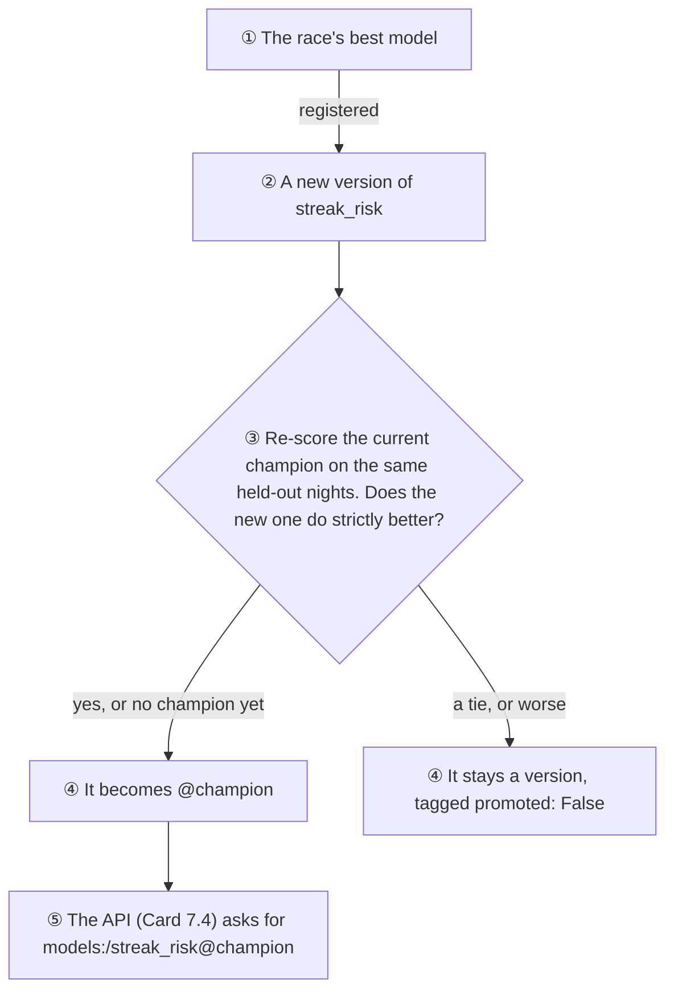
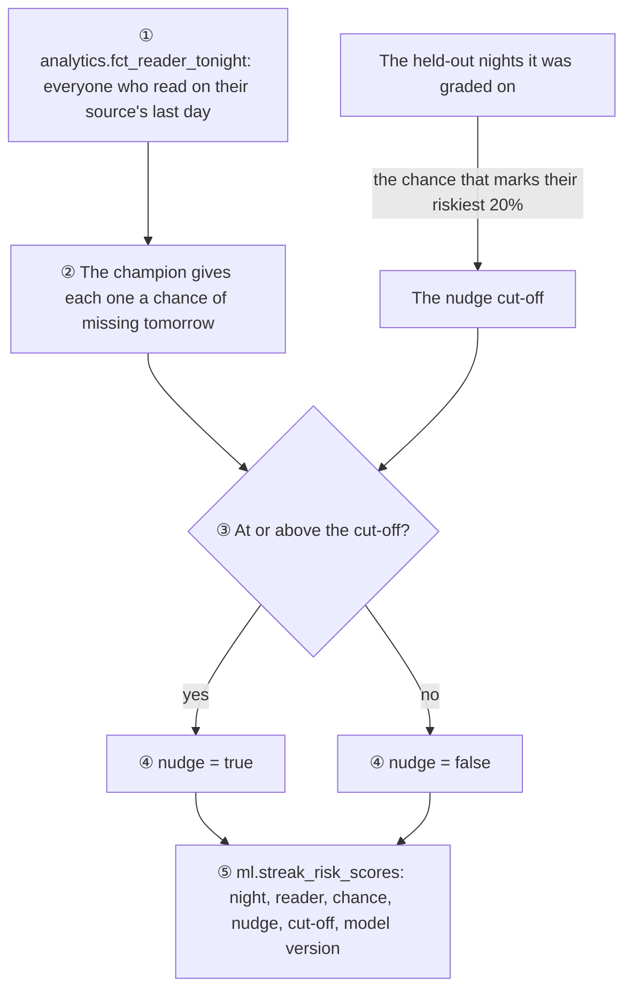

# Morning Manna ML

Pretend readers, the answer key the models are graded against, and the models themselves. The first one, streak risk, is built; reader personas and the best reminder time are next in Card 7.

Python 3.11+ · NumPy · scikit-learn · XGBoost · LightGBM · MLflow

## Pretend readers

There are no real users yet, so the pipelines, the warehouse and the models need practice data. [simulate.py](simulate.py) makes it, with habits that look like people's:

| Persona | Share | Habit |
|---|---|---|
| Early riser | 35% | Wakes around 05:15 and reads soon after, almost every day |
| Commuter | 40% | Reads on the way to work; dips at weekends |
| Weekend reader | 25% | Reads most on Saturdays and Sundays |

Readers live in five time zones (Lagos, New York, London, Manila and Chicago). Their streaks break, and some drift away for good.

**The reminder experiment.** A fair coin puts each reader in group A or B of the [reminder test](../docs/analysis/reminder-experiment.md), and wording B carries a planted effect: readers in group B whose reminders are on are a little likelier to read each morning. It's the practice run's answer key. The analysis never reads it, and is checked against it only once it's done. The coin has a random stream of its own, so group A readers live exactly the mornings they did before the experiment existed.

[true_effect.py](true_effect.py) opens the answer key: it simulates the same readers twice, with the effect and without it, to measure what the effect is truly worth on day-7 return (**+5.9 points** in one long run; the 1,200-run drill in [analytics/experiments/drill.py](../analytics/experiments/drill.py) pins it to **+5.5**). It was run only after the analysis's verdict was merged. From the repo root, it takes about a minute:

```bash
python ml/true_effect.py
```

Every reader and event is marked `synthetic`, and none of it goes near the app's own tables.

```bash
# From the repo root
python ml/simulate.py                       # 5,000 readers, the 90 days up to yesterday
python ml/simulate.py --end 2026-10-27      # the same days every time
python ml/simulate.py --readers 200 --days 30 --seed 3
```

The same seed (7 by default) and the same end date always make exactly the same readers. That's how CI and two different computers can check each other to the last event. With `--end 2026-10-27`: 5,000 readers, 179,077 events, and an answer key of 151,664 reader-days.

It writes a small data lake, laid out the way the S3 bucket holds it:

```
data/lake/readers/synthetic.jsonl                one line per reader
data/lake/events/dt=2026-10-27/synthetic.jsonl   one line per event, filed by the day it arrived
```

Then [pipelines/README.md](../pipelines/README.md#the-loader) uploads and loads it.

## 🔑 The answer key (Card 7)

Each morning, the simulator knows each reader's **true chance of finishing a reading**: whether they stay (some leave for good, most likely in their first days), how keen they still are, their weekday habit, their streak, and their reminder wording. It saves that chance for every reader-day, apart from the lake:

```
data/answer_key/finish_chance.csv.gz             user_key, day, finish_chance
```

It never goes into the warehouse, so the models in Card 7 can't see it. They're graded against it afterwards, the way the A/B test's verdict was. Saving it draws no random numbers, so the lake comes out byte for byte the same as before it existed (a test checks).

The first thing it graded was the warehouse itself. [Notebook 03](../analytics/notebooks/03_streak_risk_data.ipynb) puts each night's label next to the truth about the next morning, and they agree: **70.40%** of nights were followed by a miss, against **70.40%** expected, and so on down every streak length.


## 🔥 The streak-at-risk model (Card 7.2)

Tonight, how likely is a reader on a streak to miss tomorrow morning? [streak_risk.py](streak_risk.py) trains four models to answer it, from the warehouse's `fct_reader_nights`: a streak-length lookup (the baseline), logistic regression, XGBoost and LightGBM. Each is tuned on time-ordered folds, so no model learns from its own future, then graded once on the last three weeks, against the answer key.

| Model | ROC-AUC | Nudge the riskiest 20%: misses caught | Gap closed |
|---|---|---|---|
| Streak rule | 0.609 | 25.0% | 0% |
| Logistic regression | 0.646 | 30.4% | 33% |
| XGBoost | 0.662 | 31.7% | 48% |
| 🥇 **LightGBM** | **0.665** | **32.1%** | **50%** |
| *The truth (answer key)* | *0.719* | *37.4%* | *100%* |

"Gap closed" is how far each model got from the streak rule to perfect knowledge. Even the truth can't score 1.0, because a reader with a 30% chance of missing still flips a weighted coin in the morning. The whole story, with four charts: [the write-up](../docs/analysis/streak-risk-model.md).


```bash
# From the repo root, after simulate.py and dbt build
sudo apt install libgomp1           # Linux: LightGBM needs this system library (about 0.4 MB)
pip install -e "ml[models]"         # scikit-learn, xgboost-cpu, LightGBM, … (about 107 MB)
python ml/streak_risk.py            # about 25 seconds; writes ml/results/streak_risk.csv
python ml/streak_risk_charts.py     # the charts, as web pages in ml/charts/
```

The libraries are an extra, so the simulator stays light for the jobs that only need it. LightGBM uses the system's OpenMP library to train on several cores, and a minimal Ubuntu (WSL's, for one) doesn't have it: without `libgomp1`, `import lightgbm` fails with `libgomp.so.1: cannot open shared object file`. scikit-learn and XGBoost bring their own copy. On a Mac, it's `brew install libomp`. `xgboost-cpu` is XGBoost without the 291 MB of GPU libraries the full package brings, which nothing here uses. The same warehouse gives the same leaderboard to the last digit, on every run on the same computer.

## 📒 Tracking and versioning (Card 7.3)

A model on its own is just a file. [model_registry.py](model_registry.py) writes down how each one came to be, with **MLflow**: every race becomes a run with the charts and the leaderboard, and each model gets a run of its own, with its settings, its scores, the libraries it needs, and the model itself.


Then the race's best model is registered as a new version of `streak_risk`, and it has to earn the **`@champion`** alias:




The champion is re-scored rather than trusted from its old tag, so the comparison stays fair when the data moves on. A tie keeps the old champion: a new model has to be better, not just as good.

```bash
# From the repo root, after dbt build
pip install -e "ml[models,tracking]"     # MLflow, about 113 MB more
python ml/model_registry.py              # trains, tracks and registers (about 30 seconds)

# Then look around, at http://localhost:5000
MLFLOW_DISABLE_TELEMETRY=true mlflow ui --backend-store-uri sqlite:///ml/mlruns/mlflow.db
```

- **Where it lives:** a SQLite file and the saved models in `ml/mlruns/`, which git ignores. The models' versions live in the registry, not in git. Setting `MLFLOW_TRACKING_URI` sends everything to an MLflow server instead, with no code change.
- **Safe to load:** MLflow saves scikit-learn models with **skops**, not pickle. Pickle runs whatever code a file contains, so a tampered model could do anything. skops rebuilds only the types it's told to trust, and each model trusts just the few it needs (`TRUSTED`).
- **Nothing leaves the machine:** MLflow 3 sends usage statistics to its makers by default. `model_registry.py` switches that off, and so does `MLFLOW_DISABLE_TELEMETRY=true` in front of `mlflow ui`.
- **Loaded back exactly:** every run checks that the registered model predicts exactly what it did before it was saved.

## 🔔 The streak-at-risk service (Card 7.4)

[serve.py](serve.py) puts the champion behind a small web API. It loads `models:/streak_risk@champion` once, when it starts, and anything that can send JSON (the nightly scoring in Card 7.5, the app, or you) can ask it about tonight's readers.

| Endpoint | What it answers |
|---|---|
| `GET /health` | Is it up, and is a model loaded? |
| `GET /model` | Which version is serving, and how it scored on held-out nights |
| `POST /streak-risk` | For up to 1,000 streak nights at once, each reader's chance of missing tomorrow, and which version said so |


```bash
# From the repo root, after python ml/model_registry.py has crowned a champion
pip install -e "ml[models,tracking,serving]"
uvicorn --app-dir ml serve:app --port 8001      # then open http://localhost:8001/docs
```

- **It speaks the reader's language.** Callers send `"reminder_variant": "B"`, not the model's `wording_b = 1`. The service translates, and always builds the exact columns the model learned from.
- **Impossible nights are refused** with a clear error (422) before the model sees them: a rate above 100%, an 8th weekday, a streak of 0, a third wording, or a misspelled field.
- **It says exactly what the model says.** A test sends 300 held-out nights through the API and checks every answer against the model run directly, to the last digit.
- **Every answer is traceable:** it names the model version that gave it.
- **No champion yet?** It still starts, and says so plainly (503, with what to run) instead of crashing.
- **It's its own service, apart from the app's API in `backend/`,** so the app never carries the model libraries (over 200 MB), and either one can be restarted without the other. To pick up a new champion, restart it.
- **It's quick:** a batch of 1,000 nights takes about 20 milliseconds.

## 🌙 Tonight's scores (Card 7.5)

Every night, some readers have a streak to protect. [score_tonight.py](score_tonight.py) asks the champion about each of them and decides who gets a gentle nudge:



```bash
# From the repo root, after dbt build, once a champion is crowned
python ml/score_tonight.py
```

- **One feature recipe.** Tonight's features come from `int_reader_nights`, the same dbt model the training table reads from, so the numbers the model is asked about are worked out exactly the way the ones it learned from were.
- **A fixed cut-off, not a quota.** The cut-off comes from the held-out nights the model was graded on (Card 7.2): the chance that marks their riskiest fifth, about 42% for the current champion. Rehearsal caught the quota's flaw: "the riskiest fifth" of a single real reader is nobody, so a lone reader at 56% would never have been nudged. With a cut-off, the rule is the same for one reader or 10,000, and a calm night nudges fewer people than a shaky one.
- **Every row is traceable:** the chance, the cut-off it was compared with, and the model version that gave it.
- **Safe to re-run.** Scoring a night again replaces its scores in one transaction: all of them land, or none do.
- **Its own schema.** The scores live in `ml`, apart from the app's tables (`public`), the loader's (`raw`) and dbt's (`analytics`).

Run by hand for now. Card 9 hands it to Airflow, together with the MLflow server: in a container, the model store's file paths (written on this machine) don't resolve, and the server is the proper fix.

## Tests

```bash
cd ml
pip install -e ".[dev,models,tracking,serving]"
pytest          # 58 tests
```
