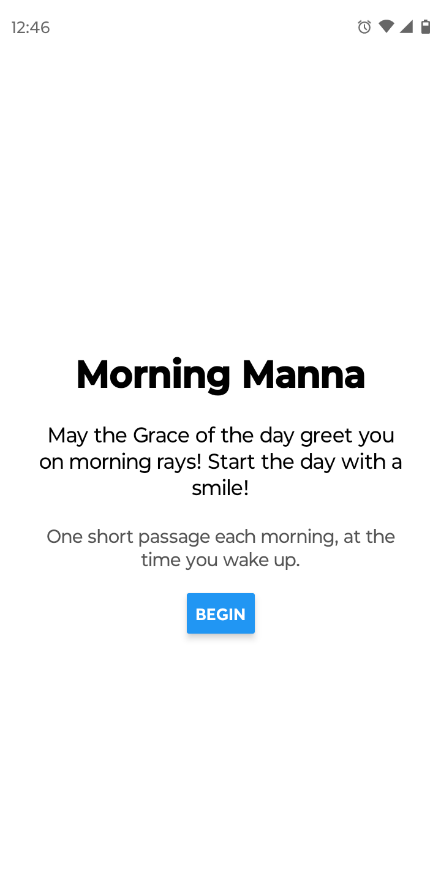
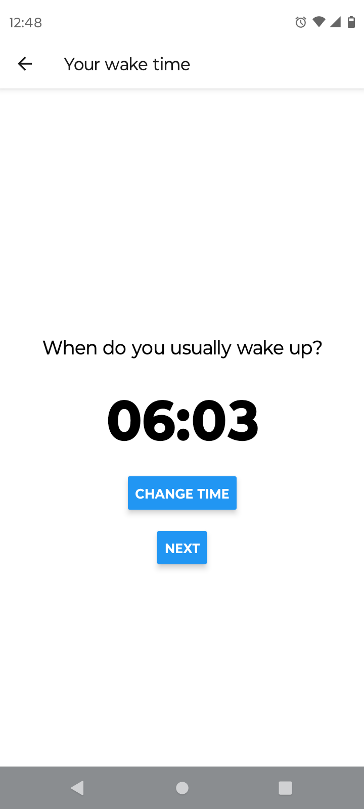
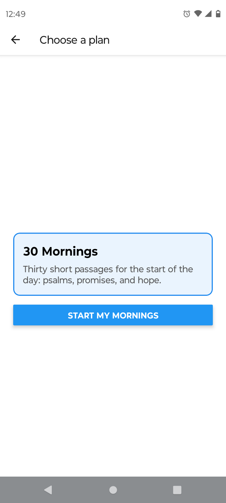
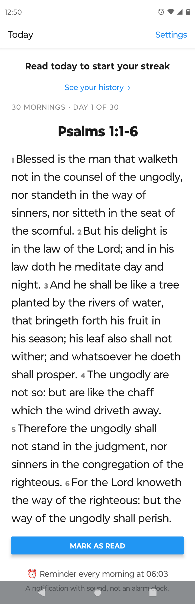
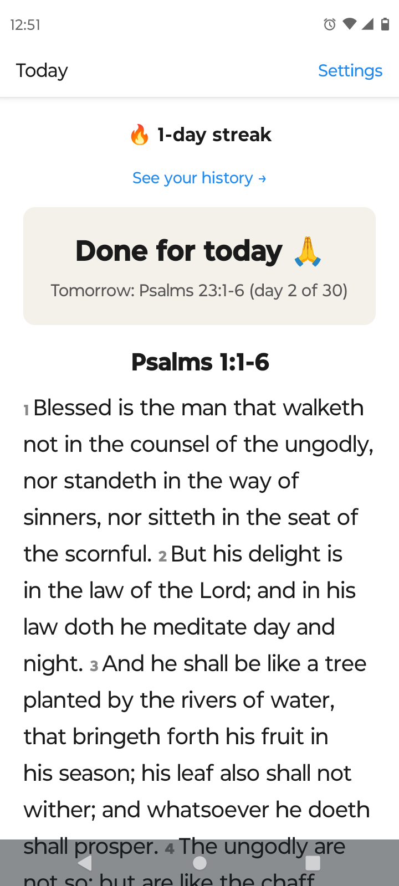
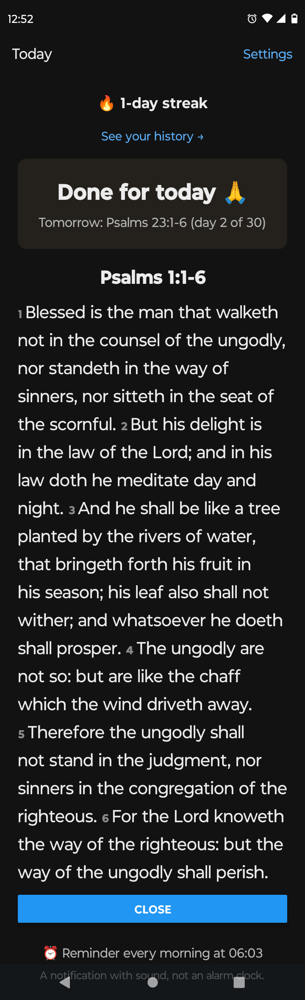
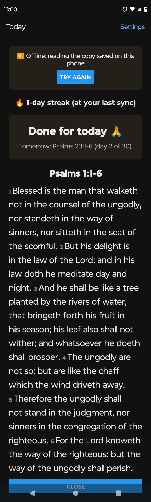
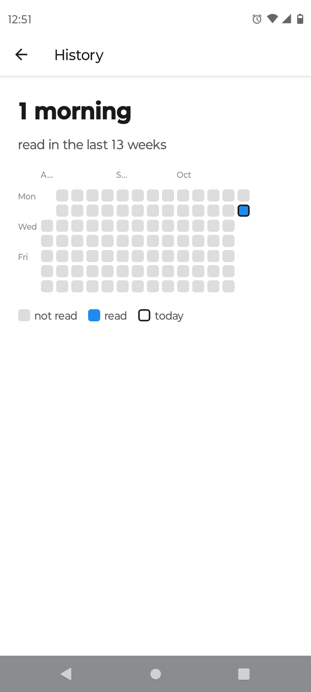
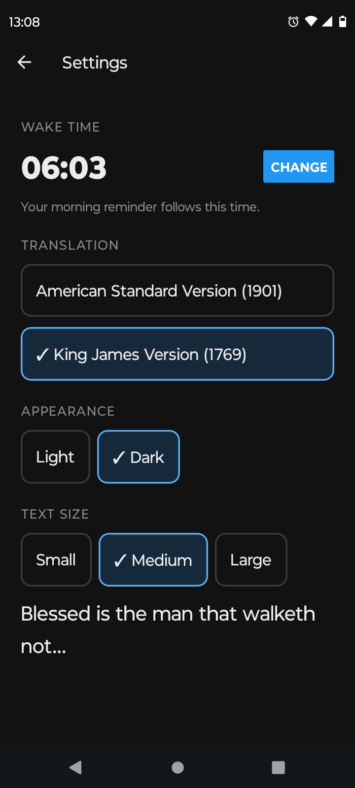
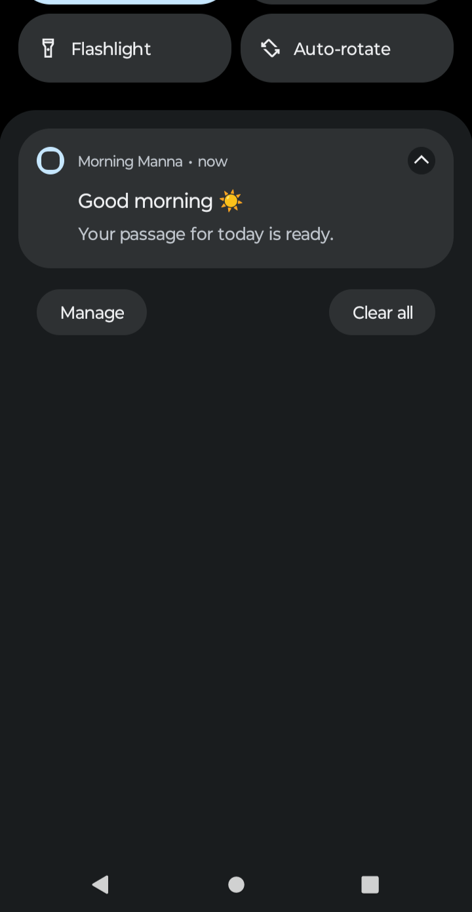

# Morning Manna app

The app people install on their phones (Android, for now): one short Bible passage each morning, at the time you wake up. You mark it read, build a streak, and can read without a connection.

Expo SDK 57 · React Native 0.86 · TypeScript · Expo Router · EAS Build

<table>
  <tr>
    <td valign="top"></td>
    <td valign="top"></td>
    <td valign="top"></td>
  </tr>
</table>

<table>
  <tr>
    <td valign="top"></td>
    <td valign="top"></td>
    <td valign="top"></td>
    <td valign="top"></td>
  </tr>
</table>

<table>
  <tr>
    <td valign="top"></td>
    <td valign="top"></td>
    <td valign="top"></td>
  </tr>
</table>

## What it does

- **Onboarding:** pick a wake time and a reading plan. The app signs up and keeps its token in secure storage.
- **Today:** this morning's passage with verse numbers, and **Mark as read**. Then "Done for today", with tomorrow's reference and a button to read today's passage again.
- **Streak:** the current streak on Today, and a 13-week heat map of every morning read on History.
- **Morning reminder:** a notification every day at your wake time.
- **Settings:** wake time, translation (King James or American Standard), light or dark, and text size.
- **Offline:** the next 7 passages are saved on the phone. With no connection you can still read and mark as read, and the reading is sent when the connection comes back.

## Run it

You need Node, an Android phone and an [Expo account](https://expo.dev). The API must be running and reachable from the phone: see [backend/README.md](../backend/README.md), and start it with `--host 0.0.0.0`.

```bash
cd mobile
npm ci
cp .env.example .env    # then put your computer's Wi-Fi address in EXPO_PUBLIC_API_URL
```

The app runs in its own **development build**, not Expo Go: Expo Go couldn't load `expo-notifications` on the test phone. Install the EAS command line once, then build. Rebuild only when a native package changes:

```bash
npm install -g eas-cli
eas build --profile development --platform android
```

Install the APK from the link EAS gives you, then start the dev server and pick it in the app:

```bash
npx expo start
```

The phone and the computer must be on the same network, and the computer's firewall must allow ports 8000 (API) and 8081 (Expo). After editing `.env`, restart with `npx expo start --clear`.

On Windows PowerShell, use `npx.cmd` and `eas.cmd` if scripts are blocked.

## Standalone build

The **preview** profile builds an APK that runs without the dev server. EAS builds in the cloud and `.env` isn't uploaded, so the API address is stored in the EAS `preview` environment:

```bash
eas env:set --environment preview --name EXPO_PUBLIC_API_URL --value "http://<Wi-Fi address>:8000" --visibility plaintext --scope project
eas build --profile preview --platform android --no-wait
```

The address is fixed into the app when it's built: if it changes, set it again and rebuild. The preview and the development build share one package name, so installing one replaces the other.

If Android says "App not installed", Play Protect may be blocking the APK: in the Play Store, open Play Protect's settings, pause scanning, install, then turn it back on.

## Layout

```
src/
  app/              screens (Expo Router: each file is a screen)
    _layout.tsx     navigation, theme, onboarding guard, analytics on open
    welcome.tsx     onboarding: welcome, wake time, plan
    wake-time.tsx
    plan.tsx
    index.tsx       Today: passage, Mark as read, streak, offline fallback
    history.tsx     heat map of mornings read
    settings.tsx    wake time, translation, appearance, text size
  api/client.ts     typed calls to the API, 10 s timeout
  session.tsx       token and onboarding state (secure storage)
  appearance.tsx    light and dark palettes, text size
  reminders.ts      the daily local notification
  events.ts         analytics events, batched and saved on the phone
  offline.ts        saved passages, readings waiting to sync
  offline-today.tsx Today without a connection
  read-again.tsx    today's passage again, after Mark as read
  store.ts          small JSON values in phone storage (AsyncStorage)
  calendar.ts       plain-date helpers for the heat map
  time.ts           wake time helpers
```

## Design decisions

- **The server decides the passage.** The app shows what `GET /today` returns: the reader's next unread day, so a missed morning is resumed, never skipped.
- **Offline readings keep their real times.** A reading finished offline is saved with its own `opened_at` and `completed_at`, and sent oldest first when the app is back online, so the streak counts the morning it really happened. Readings the API will never accept (404, 409, 422) are dropped; anything else waits for the next try.
- **Ten seconds, then offline.** Android's networking waits forever by default, so every request gives up after 10 s and Today falls back to the saved copy.
- **Reminders are local.** The phone schedules its own daily notification, so no push server is needed. It follows the wake time saved on the server.
- **Events are batched.** App events are sent 10 at a time, or when the app goes to the background. Up to 100 wait on the phone, even through a restart.

## Checks

```bash
npx tsc --noEmit
```

CI runs `npm ci` and the type check on every push.

## Known limits

- The standalone build calls the API over plain `http://` on the local network (`usesCleartextTraffic`). A public release needs the API behind https, and that setting removed.
- Tested on Android only (a Motorola phone). iOS hasn't been built or tested.
- One reader per phone: clearing the app's storage signs up a new reader. The old readings stay on the server, but the phone can't reach them again.
- "Read again" shows the passage in the translation it was read in.
