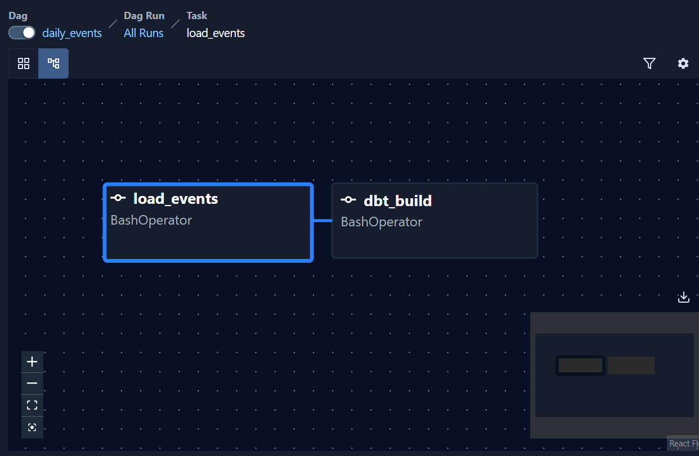

# Morning Manna pipelines

The jobs that move the app's events from the data lake into the warehouse, and the Airflow DAGs that run them every night.

Python 3.11+ · boto3 · psycopg 3 · Airflow 3.3 · SeaweedFS (S3)



## How an event travels

1. **The app** sends a batch of events to the API (`POST /events`).
2. **The API** stores them in Postgres, then copies the batch to the lake as one JSON-lines file ([backend/app/lake.py](../backend/app/lake.py)). If the lake is down, the request still succeeds.
3. **Every night at 00:30 UTC**, Airflow's `daily_events` loads yesterday's lake folder into the warehouse table `raw.events`.
4. **Then dbt** rebuilds the retention tables from it (see [analytics/README.md](../analytics/README.md)).

## The lake

SeaweedFS runs in docker compose and speaks the same S3 language as Amazon S3: the S3 API is on port 8333, and you can browse the files at http://localhost:8888. (The blueprint picked MinIO, but MinIO took its images off Docker Hub.) Everything lives in the bucket `morning-manna-lake`:

```
events/dt=2026-10-27/synthetic.jsonl   the pretend readers' events (ml/simulate.py)
events/dt=2026-10-28/app-<id>.jsonl    the app's events, one file per batch
readers/synthetic.jsonl                the pretend readers themselves
```

Each event is filed under the day it **arrived** (in UTC), so a day's folder is complete once that day is over.

## The loader

```bash
# From the repo root, in the backend's venv (the pipelines package is installed there)
docker compose up -d db lake
pip install -e "pipelines[dev]"
python ml/simulate.py --end 2026-10-27     # 5,000 pretend readers, written to data/lake/
python -m ingest.upload                    # copy data/lake/ into the bucket
python -m ingest.load_events --all         # every day in the lake, into raw.events
python -m ingest.load_events --date 2026-10-27   # or just one day
```

What it promises:

- **Loading a day again replaces it.** The day is deleted and re-copied in one transaction, so a re-run never counts anything twice, and the warehouse always mirrors the lake.
- **Bad lines are rejected and counted, never loaded:** lines that aren't JSON, unknown event types, missing fields, times without a time zone, and the same event twice.
- **Every run is logged** in `raw.load_runs`: status, rows read, loaded and rejected, and any error.

## Airflow

```bash
docker compose up -d --build airflow
```

The first build takes a few minutes. Then open http://localhost:8080. There's no login, because the page can only be reached from your own computer.

| DAG | When | What it does |
|---|---|---|
| `daily_events` | 00:30 UTC every day | `load_events` (yesterday's lake folder into `raw.events`), then `dbt_build` |
| `ingest_scripture` | By hand | The Bible pipeline from [backend/README.md](../backend/README.md#data-pipeline) |
| `retrain_models` | Weekly | A placeholder until the models arrive in Phase 7 |

New DAGs start paused: switch one on with the toggle beside its name.

**Which day a run loads.** A night's run loads the day before its date. To load a different day, press **Trigger** and fill in **day**. To load a stretch of past days, backfill. Each run loads the day before its date, and the end date isn't included, so this loads 1 to 27 October:

```bash
docker compose exec airflow airflow backfill create --dag-id daily_events \
  --from-date 2026-10-02 --to-date 2026-10-29
```

**How the image is built** ([Dockerfile](Dockerfile)):

- Airflow runs in **standalone** mode: the scheduler, the web page and the workers share one container. It uses about 850 MB of memory when idle, and about 1.1 GB during a run.
- Each job has **its own Python** (venv) in the image, so the backend's, the loader's and dbt's libraries never clash with Airflow's.
- Your code is **mounted read-only** at `/opt/manna`. The jobs can read it but never change it. Only `data/` is writable, for the Bible downloads.
- Changing code needs no rebuild. Adding a dependency does: `docker compose up -d --build airflow`.
- Airflow keeps its own records in a separate Postgres (`airflow-db`), away from the app's tables.

## Tests and CI

```bash
cd pipelines
pytest                    # the loader: 13 tests (needs: docker compose up -d db)
```

The loader's tests run against a real Postgres and a stand-in S3 server (moto), with a fresh schema for each test, so they never touch `raw`.

The DAG tests need Airflow itself, so they run inside the Airflow container:

```bash
docker compose exec airflow bash -c "pip install -q pytest && python -m pytest -p no:cacheprovider /opt/manna/pipelines/dag_tests"
```

On every push, GitHub Actions runs three jobs for this folder:

1. **pipelines:** `ruff check .` and the loader's tests.
2. **airflow:** builds the image, checks that each job's Python can load its code, and runs the 7 DAG tests inside it.
3. **analytics:** builds the whole warehouse from nothing, through this loader (see [analytics/README.md](../analytics/README.md)).

## Layout

```
ingest/
  settings.py      where the lake and the warehouse are (environment variables)
  upload.py        copy data/lake/ into the bucket
  load_events.py   lake to raw.events and raw.readers, logged in raw.load_runs
dags/              the Airflow DAGs
dag_tests/         tests for the DAGs (need Airflow)
tests/             tests for the loader
Dockerfile         the Airflow image
```
